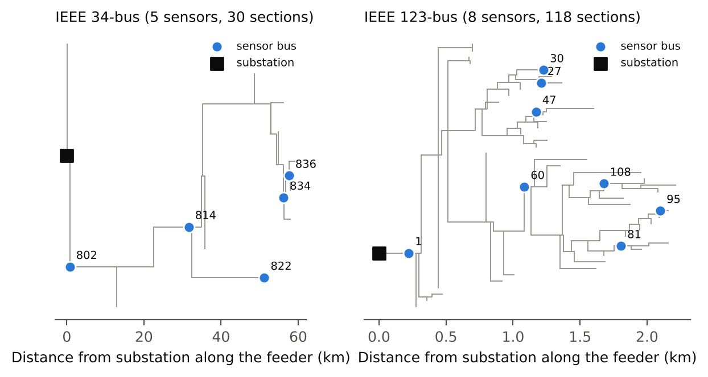
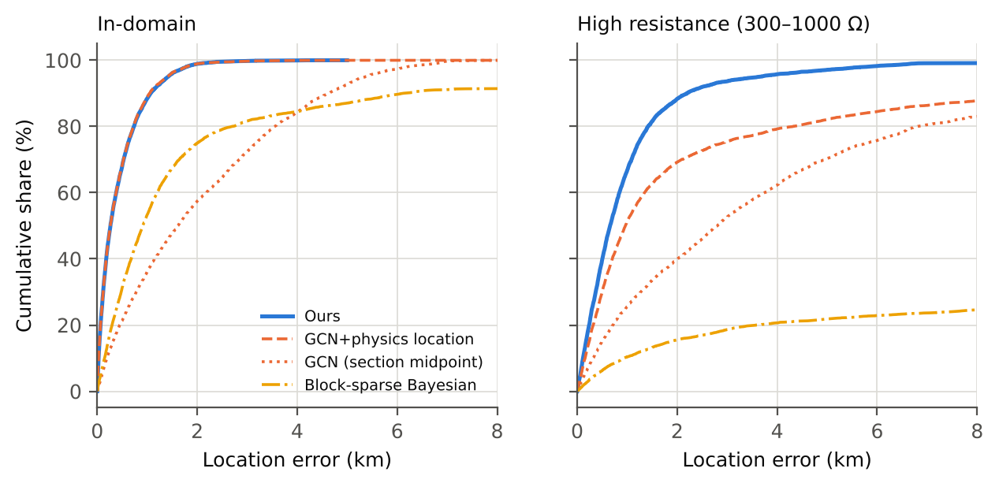
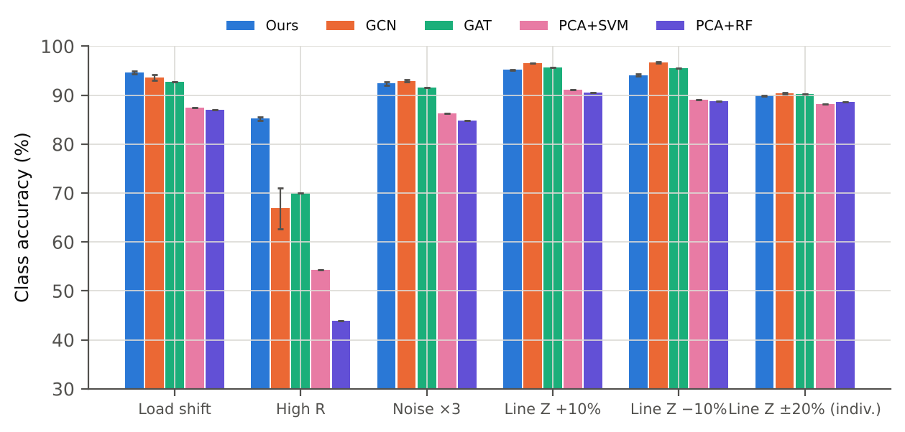

# Fault Location in Distribution Networks under Extremely Sparse Measurements: Data-Driven Screening with Physics-Based Closed-Loop Verification

*First draft (all results are from OpenDSS simulations; no field data are used)*

## Abstract

With only a handful of synchronized sensors in a distribution network, existing fault-location methods each fall short: data-driven methods lose accuracy when test conditions leave the training distribution, and physics-based inversion, which is insensitive to the training distribution, cannot separate sections whose responses are similar. We propose a two-stage method of data-driven screening and physics-based closed-loop verification: a neural network narrows the faulted section to two candidates, a physics-based inversion with a real-valued fault resistance verifies each candidate and estimates the position within the section, and a Bayesian joint score combines the two pieces of evidence; when no candidate explains the measurements the search is widened, and if it still fails a mismatch alarm is raised. On the IEEE 34-bus feeder (5 sensors, 30 sections), when the fault resistance leaves the training range (300–1000 Ω) our method reaches a section accuracy of 85.2%, against 70.0% for the best external method compared; within the training distribution it is on par with the strongest baseline (97.0% against at most 97.1%); restricting the fault resistance to a real number raises the section accuracy of the physics-based inversion by 6.6–12.4 percentage points in all 16 scenarios; and in the four fixed-tap scenarios it is 10.9–26.7 percentage points above the two-stage method of Liang et al. On the IEEE 123-bus feeder (8 sensors, 118 sections) it is significantly better than the other methods in 5 of 7 scenarios. Under line-impedance errors some baselines are more accurate; a diagnosis with the true per-line impedances shows that the larger position error comes from line-parameter mismatch. All results are from simulation.

**Keywords:** fault location; distribution network; extremely sparse measurements; physics-based inversion; data-driven; out-of-distribution generalization

## 1 Introduction

Distribution feeders have many sections and branches, and locating a fault by patrol is slow; shortening location time is a key step in shortening outages [1,2]. The cost of synchronized phasor devices (μPMUs) means that far fewer sensors can be installed than there are sections. We call this the extremely sparse measurement setting: five sensors cover the 30 sections of the IEEE 34-bus feeder, and eight cover the 118 sections of the IEEE 123-bus feeder.

Existing methods fall into two families. Physics-based methods use the network model: impedance-based methods [3,4], voltage-sag and response matching [5,6], sparse recovery and compressed sensing [7,8,9], and two-stage methods that screen candidates and then run a nonlinear state estimation [10]. They do not depend on training data, but with very few sensors the responses of different sections are similar and the residual separates them poorly. Data-driven methods learn a mapping from measurements to the fault location with support vector machines and ensembles [11,12,13], convolutional networks [14,15] and graph neural networks [16,17,18]. They are accurate within the training distribution but degrade when test conditions leave it. In the papers we reviewed, the fault resistance and load level of the test set generally follow the training distribution, and extrapolation beyond the training range is rarely tested (see Section 2).

The two families fail under different conditions: data-driven methods fail outside the training distribution, physics-based methods fail between sections with similar responses. We therefore propose a two-stage method in which a neural network screens the faulted section down to two candidates, a physics-based inversion with a real-valued fault resistance verifies each candidate and estimates the position within the section, and a Bayesian joint score combines the two pieces of evidence. When neither explains the measurements, the search is widened, and if it still fails a model-mismatch alarm is raised.

The contributions of this paper are:

1. A two-stage method in which a neural network selects two candidates from all sections, a physics-based inversion verifies each, and a joint score decides; when no candidate explains the measurements the search is widened, and if it still fails a mismatch alarm is raised. At 300–1000 Ω on IEEE 34 the class accuracy rises from 68.5% for the neural network plus physics-based location to 85.8%.
2. A physics-based inversion in which the fault resistance is restricted to a real number, with a real gain under a prior. In-domain on IEEE 34, the class accuracy of the exhaustive inversion rises from 82.7% to 90.3%, and it improves in all 16 scenarios.
3. A comparison on IEEE 34 and IEEE 123 with four published methods and two machine-learning baselines, covering extrapolation in fault resistance, load and noise and both global and per-line line-parameter errors; the scenarios where our method is and is not ahead are reported, and a diagnosis with the true per-line impedances points out the source of the loss under line-parameter errors.

## 2 Related Work

**Physics-based methods.** Impedance-based methods estimate the fault distance from the apparent impedance and are sensitive to fault resistance and load [3]; extensions with synchrophasors and distributed generation are given in [4]. Voltage-sag methods use impedance matrices and block partitioning to make the equations solvable [5]; others select a branch with a classifier and then match against a simulated library by similarity [6]. Sparse-measurement methods model the fault as a sparse virtual injection current and solve it by Bayesian compressed sensing or block-sparse Bayesian learning, and discuss the minimum number of meters [7,8,9,19,20]; Jia et al. further use a two-stage method with sparse hybrid measurements [21]. The two-stage method of Liang et al. screens suspect lines with a linear model matching of virtual currents and then runs a nonlinear fault state estimation on the candidates to locate the fault within the line [10]; it is the closest in structure to ours. It differs in that its first stage has no learned prior; judging from its abstract, it has no joint score of neural-network probability and physics residual, and no mismatch alarm after widening the search.

**Data-driven methods.** Classical machine learning trains SVMs, artificial neural networks, random forests or their stacks on voltage and current features [11,12,13,22]; deep learning includes convolutional networks [14,15,23] and graph networks. Chen et al. classify the faulted bus of the IEEE 123-bus system with Chebyshev graph convolutions and compare with PCA+SVM, PCA+random forest and a fully connected network [16]; later work includes graph attention networks [17], spatio-temporal graph networks [18], graph networks with edge attributes [24] and deep graph learning [25]. Khattak and Choudhry train a convolutional network on pre/post-fault difference phasors from 5 and 9 PMUs on modified IEEE 34- and 123-bus systems [15]; the number of sensors is close to ours, but their evaluation includes no noise, no load shift and no fault resistance beyond the training range, and no physics-based inversion.

**Combining physics and data.** Existing work puts physical structure into the network: Li and Deka build the adjacency matrix from the physical structure and learn embeddings and propagate labels in two stages [26]; Zheng et al. add a Kirchhoff current-law residual term to the loss of a graph attention network [27]; Hu et al. use the physical network structure as a training constraint [25]. In these methods physics acts on the training or the network structure; no physics-based inversion is solved at inference time, and there is no residual-based verification or alarm. On line-parameter errors, Shan et al. report robustness to them [20], and Yu et al. first calibrate line parameters from steady-state data [28]. Theoretical work on low-observability settings notes that with far fewer sensors than observability requires, a fault can only be localized to a subgraph rather than a single line [29,30], which is consistent with our use of candidates followed by verification.

Table 1 summarizes the closest methods. In the literature we reviewed, we did not find work that jointly scores neural-network probability and physics residual, widens the search and raises a mismatch alarm when all candidate residuals are large, and systematically tests fault resistance beyond the training range; this judgment rests on abstracts and partial full texts and is not a substitute for an exhaustive search.

**Table 1 Methods closest to this paper (compiled from abstracts and available full texts)**

| Method | Category | Input and sensors | Physics model at inference | Out-of-distribution test | Mismatch alarm |
|:--|:--|:--|:--|:--|:--|
| This paper | Neural network + physics inversion | Phasor disturbance, 5/8 sensors | Yes (real-resistance inversion) | Yes | Yes |
| Liang et al. 2025[10] | Linear matching + nonlinear state estimation | μPMU phasors, optimized placement | Yes | Not reported | Not reported |
| Jiang et al. 2021[8] | Block-sparse Bayesian learning | Synchronized phasors, IEEE 123 | Yes | Not reported | No |
| Khattak & Choudhry 2025[15] | 1-D CNN | Pre/post-fault difference phasors, 5/9 PMUs on IEEE 34/123 | No | No (no noise, no load shift, Rf ≤ 10 Ω) | No |
| Chen et al. 2019[16] | Graph convolutional network | During-fault phasors, 25 sensors on IEEE 123 | No | Load level, noise, topology change | No |
| Li & Deka 2023[26] | Physics-preserved graph network | Phasors, 21 sensors on IEEE 123 | No (structure only) | Load and topology change | No |
| Zheng et al. 2026[27] | Dual-graph physics-informed GAT | IEEE 33 | No (KCL residual as regularizer) | Noise, missing data | No |

## 3 Method

### 3.1 Measurement model and overall procedure

Let the sensors provide $m$ complex measurements (the three-phase voltages at each sensor bus and the three-phase currents of one adjacent line); the difference of the phasors after and before the fault is the disturbance $\mathbf z\in\mathbb C^{m}$. After linearization, a fault at position $(s,\alpha)$ (section $s$, position $\alpha\in(0,1)$ within the section) on phase set $\tau$ satisfies $\mathbf z=\mathbf G_{\tau}(s,\alpha)\,\mathbf i+\mathbf n$, where $\mathbf G_{\tau}(s,\alpha)$ is the response to a unit injection current on the faulted phases (obtained from the nodal admittance matrix), $\mathbf i$ is the injected current and $\mathbf n$ is the measurement noise. The method has three stages: stage 1 gives the posterior probability of each section with a neural network and keeps the top $k=2$ candidates; stage 2 runs a physics-based inversion on each candidate and returns a weighted residual $J$ and the position within the section; stage 3 combines the two to make the decision, widening the candidate set or raising an alarm when necessary (Fig. 1).

*Fig. 1 Block diagram. A neural network selects the Top-2 candidate sections from all sections, a physics-based inversion verifies each candidate and estimates the position within the section, and a joint score makes the decision; when all candidate residuals are large the search is widened to all sections, and if it is still large a mismatch alarm is raised.*

### 3.2 Stage 1: section posterior

The complex amplitude of the fault current is unknown, so the features are the real and imaginary parts of the ratio of each component to the largest-magnitude component, $\mathbf u=\mathbf z/z_{\mathrm{ref}}$, plus the log signal-to-noise ratio $\log_{10}(|z_i|/\sigma_i)$ of each component and of the reference component, $3m+1$ features in all. The classifier is a fully connected network (160-160-96 for IEEE 34, 256-256-192 for IEEE 123) that outputs the softmax probability $P(s\mid\mathbf z)$ of each section. Noise is re-drawn for every training batch; besides samples with nominal line impedance, the training set contains samples with line-impedance scales of 0.88, 0.94, 1.06 and 1.12, so that the network is not overly sensitive to a global line-parameter error.

### 3.3 Stage 2: physics-based inversion with a real fault resistance

If the injected current $\mathbf i$ is a free complex vector, each section gains a complex degree of freedom that, with few sensors, suffices to fit the response of other sections, and the residual gap between sections shrinks. In reality the fault current is determined by the fault resistance $R$ (a real number) and the impedance at the fault point. Let $\mathbf V_{f}^{\mathrm{pre}}$ be the pre-fault voltage at the fault point, $\mathbf Z_{ff}$ the self-impedance matrix at the fault point and $\mathbf E$ the connection matrix of the faulted phases; the fault current is $\mathbf i_f(R)=(R\mathbf E+\mathbf Z_{ff})^{-1}\mathbf V_f^{\mathrm{pre}}$, and the injection is $\mathbf i=-\mathbf i_f$ (a differential form for phase-to-phase faults). A real gain $g$ absorbs the deviation of the pre-fault voltage from its nominal value, with prior $g\sim\mathcal N(1,\sigma_g^2)$ ($\sigma_g=0.05$), so that

$$J(s,\alpha,R,g)=\big\|\mathbf W^{1/2}\big(\mathbf z-g\,\mathbf G_{\tau}(s,\alpha)\,\mathbf i(R)\big)\big\|^{2}+\Big(\frac{g-1}{\sigma_g}\Big)^{2},\qquad W_{ii}=\frac{1}{\sigma_i^{2}+(\varepsilon_r|z_i|)^{2}+(\varepsilon_a z_{\max})^{2}}$$

In the weights, $\varepsilon_r=2\%$ and $\varepsilon_a=1\%$ represent the linearization model error and $z_{\max}$ is the largest magnitude among measurements of the same kind. For each candidate section, $J$ is evaluated on 49 equally spaced positions $\alpha\in[0.02,0.98]$ and a 48-point logarithmic grid $R\in[0.01,3000]\,\Omega$ ($g$ has a closed form), and $R$ is then refined on 13 points around the optimum. Five line-impedance hypotheses (0.9, 0.95, 1.0, 1.05 and 1.1 times) are each evaluated, with penalized residual $J_{\mathrm{pen}}=J+((s_z-1)/0.05)^2$ ($s_z$ is the impedance scale), and the smallest is kept; the reported residual $J$ excludes this prior term. The outputs are $J_{\mathrm{pen}}$, $J$, the position estimate $\hat\alpha$ and the fault type.

### 3.4 Stage 3: joint score, candidate expansion and alarm

The score of a candidate is $S_s=\ln P(s\mid\mathbf z)-\lambda\,J_{\mathrm{pen}}(s)$ and the candidate with the largest score is chosen; $\lambda$ is fitted on a validation set by maximizing the joint posterior likelihood of the true equivalence class. Let $\theta$ be the 99th percentile of the residual $J$ when the hypothesis is correct (calibrated on the validation set). If the $J$ of both candidates exceeds $\theta$, the candidate set from stage 1 is not trustworthy, and the candidates are expanded to all sections and re-scored; if the smallest $J$ after expansion still exceeds $\theta$, a model-mismatch alarm is raised. The confidence is the probability that $\mathrm{softmax}(S)$ over the candidate pool places on the equivalence class of the chosen section. Equivalence classes are defined from physical evidence: for a true fault in $s$, if in at least half of the samples the penalized residual of section $s'$ is not larger than that of $s$ by more than 4, the two cannot be distinguished; sections that are mutually indistinguishable are connected into one class.

## 4 Experimental Setup

### 4.1 Systems, sensors and data

The test systems are the IEEE 34-bus feeder (30 fault sections) and the IEEE 123-bus feeder (118 fault sections; switches are modeled as short connections), simulated with OpenDSS [31]. The five sensors of IEEE 34 are at buses 814, 836, 802, 822 and 834, and the eight of IEEE 123 at buses 60, 47, 95, 1, 108, 27, 81 and 30 (Fig. 2); they were chosen by greedy forward selection on the mean location error of exhaustive physics-based inversion. Each sensor measures the three-phase voltages of its bus and the three-phase currents of one adjacent line, giving 26 complex measurements for IEEE 34 and 44 for IEEE 123. Measurement noise is 0.1% of the nominal voltage and 0.2 A for current; the disturbance is the difference of two measurements, so the noise standard deviation is multiplied by $\sqrt2$. There are 10 fault types (single-phase-to-ground, phase-to-phase, two-phase-to-ground, three-phase-to-ground), the position is uniform over the whole network, the fault resistance in the training set is log-uniform in 0.01–300 Ω and the load multiplier is 0.6–1.1. The IEEE 34 training set has 80,000 nominal-impedance samples plus 20,000 each at line-impedance scales 0.88, 0.94, 1.06 and 1.12; IEEE 123 has 120,000 plus 30,000 each. Each test scenario has 5000 samples.

*Fig. 2 Topology of the test systems (rooted at the substation, horizontal axis is the distance along the feeder to the substation) and sensor locations.*

### 4.2 Test scenarios

All scenarios use the same trained model and only change the test conditions. “In-domain” follows the training distribution. The extrapolation and robustness scenarios are: load shift (network-wide load 1.25–1.5 times, outside the trained 0.6–1.1); high resistance (fault resistance 300–1000 Ω, outside the trained 0.01–300 Ω); noise ×3 (measurement noise tripled); line impedance ±10% (all line impedances globally larger or smaller while the model keeps nominal values); and individual line impedance ±20% (each line impedance independently 0.8–1.2 times its nominal value). The noise sensitivity sweep uses ×0.5, ×1, ×2, ×3 and ×5. For comparison with the method of Liang et al., which requires known regulator taps, there are four additional scenarios with fixed taps (in-domain, load shift, high resistance, noise ×3; 3000 samples each). Table 2 lists the purpose of each scenario.

**Table 2 Test scenarios and their purpose**

| Scenario | Setting | Purpose |
|:--|:--|:--|
| In-domain | Same as training | Overall and binned accuracy within the distribution |
| Load shift | Network load 1.25–1.5× (trained 0.6–1.1) | Load-level extrapolation |
| High resistance | Fault resistance 300–1000 Ω (trained 0.01–300 Ω) | Behaviour where data-driven methods fail |
| Noise ×3 | Measurement noise ×3 | Noise robustness |
| Line impedance +10% / Line impedance −10% | All line impedances off by ±10%, model keeps nominal | Inaccurate line parameters |
| Individual line impedance ±20% | Each line impedance 0.8–1.2× nominal, independently | More realistic model error |
| Fixed taps (4) | In-domain, load shift, high resistance and noise ×3 with fixed regulator taps | Comparison with the two-stage method of Liang et al. (requires known taps) |
| Noise levels | Noise ×0.5, ×1, ×2, ×3, ×5 | Noise sensitivity |

### 4.3 Compared methods

There are six external methods, four published methods and two machine-learning baselines, all trained on the same training set and using the same measurements. The published methods are: (1) GCN [16], Chebyshev graph convolution, with two inputs, the “paper input” (magnitude and angle of the during-fault phasors) and the “disturbance input” (the same features as stage 1); (2) GAT [17], three layers with four attention heads restricted to physically adjacent buses, with the same two inputs; (3) block-sparse Bayesian learning [8], which takes the three-phase virtual injection current at each candidate position as the unknown and estimates the block variances by EM, choosing the block with the largest energy; the position is limited to a 10-point $\alpha$ grid, no neural network is used and line parameters are nominal; (4) the two-stage method of Liang et al. [10], linear model matching for screening followed by a nonlinear fault state estimation, which assumes exactly known regulator taps and network parameters and is therefore compared only in the fixed-tap scenarios, and which receives more measurements than our method (root-bus phasors, end-bus voltage magnitudes, load pseudo-measurements). The machine-learning baselines are (5) PCA+SVM and (6) PCA+random forest, following the comparison protocol of Chen et al. [16], with the stage-1 features standardized and reduced by PCA (99% of the variance); the SVM has an RBF kernel and, because of the cost of kernel methods, is trained on a random subset of 30,000 samples. Except for the method of Liang et al. and block-sparse Bayesian learning, all classifiers output only the section, and the fault point is taken at the section midpoint. To separate section selection from position estimation we also hand each classifier's Top-1 section to stage 2 to estimate the position within the section (“+physics location”), or feed its probability into the full procedure as stage 1 (“+our procedure”). Internal references are neural-network Top-1 followed by physics-based location (hard cascade), exhaustive physics-based inversion over all sections, and an oracle with the section known. All baselines are our reimplementations from the original papers and may differ from the original authors' code; see Table A6.

### 4.4 Metrics and statistics

Section accuracy is judged at the level of equivalence classes (22 classes for IEEE 34, 64 for IEEE 123; the classes are defined from physical evidence and fixed so that all methods are scored the same way), and exact section accuracy is also reported. The location error is the absolute difference (km) between the predicted and true fault points measured along the feeder from the substation; we report the mean and, where useful, the median, P90 and quantiles. The correction rate CR and false-correction rate FCR are defined relative to the correctness of the stage-1 Top-1. Training randomness is measured with several seeds: on IEEE 34, five seeds for our method and the classifier baselines (three, seeds 0–2, for GAT and the PCA baselines), on IEEE 123 five seeds for our method and three for GCN, reported as mean ± standard deviation; a difference of means is called significant only if it exceeds twice the larger standard deviation.

## 5 Results

### 5.1 Comparison with published methods and machine-learning baselines

**Table 3 Main comparison on IEEE 34: class accuracy (%, mean ± standard deviation) and location error (km). The best in each row is in bold**

| Scenario | Ours | GCN (paper input) | GCN (disturbance input) | GAT (paper input) | GAT (disturbance input) | Block-sparse Bayesian | PCA+SVM | PCA+RF |
|:--|---:|---:|---:|---:|---:|---:|---:|---:|
| In-domain | 97.0±0.1 | 96.6±0.1 | **97.1±0.0** | 95.0 | 96.0 | 79.0 | 92.7 | 93.1 |
| Load shift | **94.6±0.3** | 88.4±1.0 | 93.5±0.6 | 90.2 | 92.7 | 78.5 | 87.5 | 87.0 |
| High resistance | **85.2±0.4** | 42.6±0.8 | 66.8±4.2 | 43.7 | 70.0 | 15.7 | 54.3 | 43.8 |
| Noise ×3 | 92.4±0.4 | **92.9±0.2** | 91.5±0.3 | 91.5 | 90.6 | 47.3 | 86.3 | 84.8 |
| Line impedance +10% | 95.1±0.1 | 95.7±0.1 | **96.5±0.0** | 93.8 | 95.6 | 76.8 | 91.1 | 90.5 |
| Line impedance −10% | 94.1±0.3 | 95.6±0.1 | **96.7±0.1** | 93.1 | 95.5 | 71.4 | 89.0 | 88.8 |
| Individual line impedance ±20% | 89.9±0.1 | **90.4±0.2** | 88.3±0.1 | 90.2 | 89.0 | 75.2 | 88.2 | 88.6 |
| **Location error (km)**: classifiers as “section midpoint / +physics location” |  |  |  |  |  |  |  |  |
| In-domain | **0.44** | 2.12 / 0.45 | 2.08 / **0.44** | 2.22 / 0.51 | 2.11 / 0.46 | 4.95 | 2.29 / 0.52 | 2.26 / 0.50 |
| Load shift | **0.64** | 2.70 / 1.19 | 2.12 / 0.66 | 2.55 / 0.95 | 2.21 / 0.65 | 4.43 | 2.62 / 0.97 | 2.80 / 1.02 |
| High resistance | **1.36** | 9.91 / 8.35 | 5.97 / 4.67 | 10.71 / 9.15 | 5.06 / 3.63 | 28.07 | 7.54 / 5.76 | 8.98 / 7.14 |
| Noise ×3 | **0.53** | 2.36 / 0.67 | 2.44 / 0.68 | 2.41 / 0.64 | 2.47 / 0.76 | 19.30 | 2.79 / 0.89 | 2.94 / 1.02 |
| Line impedance +10% | **0.73** | 2.17 / 0.77 | 2.08 / **0.73** | 2.23 / 0.79 | 2.11 / 0.74 | 5.00 | 2.30 / 0.82 | 2.33 / 0.84 |
| Line impedance −10% | 0.84 | 2.18 / 0.84 | 2.10 / **0.80** | 2.33 / 0.91 | 2.13 / 0.82 | 6.15 | 2.50 / 0.96 | 2.42 / 0.92 |
| Individual line impedance ±20% | **0.98** | 2.32 / 0.99 | 2.35 / 1.02 | 2.37 / 1.01 | 2.33 / 0.99 | 5.74 | 2.47 / 1.02 | 2.42 / 1.00 |

Table 3 gives the main comparison. Against the best of the other methods in each scenario, our method is significantly higher in 1 scenario(s) (High resistance), not significantly different in 3 (In-domain, Load shift, Noise ×3) and significantly lower in 3 (Line impedance +10%, Line impedance −10%, Individual line impedance ±20%).

The gap is largest when the fault resistance leaves the training range (300–1000 Ω): our method reaches 85.2%, the best of the other methods, GAT (disturbance input), 70.0%. In-domain, ours is 97.0%, 0.1 percentage points below the strongest baseline (GCN (disturbance input), 97.1%).

In the line-impedance-error scenarios (Line impedance +10%, Line impedance −10%, Individual line impedance ±20%) our method is below GCN (disturbance input), GCN (paper input), by 0.5–2.6 percentage points: these scenarios make the nominal response library of stage 2 mismatched, so the section decision relies mainly on stage 1, and the baselines are trained on the same data as stage 1.

The classifier baselines output only the section and the fault point is taken at the section midpoint, so their location error is much larger; once their Top-1 section is handed to stage 2 to estimate the position within the section (“+physics location”), the location error approaches that of our method, which shows that the accuracy of the position within a section comes mainly from the physics-based inversion (lower half of Table 3, Fig. 4). Block-sparse Bayesian learning estimates the position itself, but is limited by the α grid and places no constraint on the fault resistance.

*Fig. 4 Cumulative distribution of the location error on IEEE 34: (left) in-domain, (right) high resistance.*

*Fig. 5 Class accuracy of the methods under extrapolation and parameter-error scenarios on IEEE 34 (mean, error bars are standard deviations; for GCN and GAT the input with the higher accuracy in each scenario).*

**Table 4 Comparison with the two-stage method of Liang et al. in the fixed-tap scenarios (class accuracy %; Liang is the best of its four variants)**

| Scenario | Ours | Liang two-stage | GCN (paper input) | GCN (disturbance input) | GAT (paper input) | GAT (disturbance input) | Block-sparse Bayesian | PCA+SVM | PCA+RF |
|:--|---:|---:|---:|---:|---:|---:|---:|---:|---:|
| Fixed taps: in-domain | **94.5±0.1** | 81.3 | 93.6±0.3 | 91.3±0.2 | 87.5 | 91.9 | 78.6 | 90.5 | 90.3 |
| Fixed taps: load shift | **92.1±0.2** | 81.0 | 85.5±1.6 | 84.0±1.0 | 78.7 | 81.7 | 79.1 | 84.7 | 88.1 |
| Fixed taps: high resistance | **85.3±0.5** | 58.7 | 37.6±0.9 | 64.7±4.1 | 28.5 | 68.1 | 15.4 | 51.6 | 41.7 |
| Fixed taps: noise ×3 | **92.0±0.3** | 78.1 | 90.2±0.4 | 88.0±0.3 | 84.5 | 88.3 | 47.2 | 83.8 | 82.1 |

Location error (mean): Fixed taps: in-domain: ours 0.45 km, Liang 0.91 km; Fixed taps: load shift: ours 0.63 km, Liang 1.02 km; Fixed taps: high resistance: ours 1.28 km, Liang 4.36 km; Fixed taps: noise ×3: ours 0.51 km, Liang 1.36 km.

### 5.2 Accuracy by fault type, position and resistance

**Table 5 Class accuracy (%, seed 0) of the IEEE 34 in-domain samples and the high-resistance samples binned by fault type, fault position and fault resistance (the two bins above 300 Ω come from the high-resistance scenario)**

| Group | Samples | Ours | GCN (paper input) | GCN (disturbance input) | GAT (paper input) | GAT (disturbance input) | Block-sparse Bayesian | PCA+SVM | PCA+RF |
|:--|---:|---:|---:|---:|---:|---:|---:|---:|---:|
| Fault type SLG | 2677 | 97.1 | 96.5 | **97.3** | 94.6 | 95.8 | 77.5 | 92.0 | 92.1 |
| Fault type LL | 1030 | **97.1** | 96.6 | 96.6 | 94.4 | 96.0 | 81.9 | 93.8 | 95.2 |
| Fault type LLG | 962 | **97.5** | 97.1 | 97.3 | 96.0 | 96.7 | 79.3 | 92.9 | 93.5 |
| Fault type LLLG | 331 | **96.7** | 95.5 | **96.7** | 95.8 | 96.4 | 80.4 | 93.4 | 96.1 |
| Position near end (α<0.35) | 1730 | **96.4** | 96.0 | 96.2 | 94.4 | 95.3 | 73.3 | 91.7 | 91.8 |
| Position middle (0.35≤α<0.65) | 1591 | 99.1 | 98.1 | **99.2** | 97.3 | 98.7 | 81.8 | 95.5 | 96.0 |
| Position far end (α≥0.65) | 1679 | **96.1** | 95.7 | **96.1** | 93.2 | 94.3 | 82.1 | 90.9 | 92.2 |
| Rf 0–1 Ω | 2249 | 97.8 | **98.6** | 97.9 | 97.6 | 97.0 | 84.3 | 93.3 | 95.6 |
| Rf 1–10 Ω | 1137 | **98.1** | 97.9 | 98.0 | 97.2 | 97.9 | 84.9 | 94.8 | 95.5 |
| Rf 10–100 Ω | 1076 | **96.3** | 94.4 | 96.2 | 92.0 | 94.7 | 78.6 | 91.9 | 90.5 |
| Rf 100–300 Ω | 538 | **94.4** | 89.6 | 93.9 | 84.9 | 90.9 | 44.6 | 86.6 | 84.2 |
| Rf 300–500 Ω | 2149 | **90.5** | 69.6 | 86.5 | 66.5 | 81.8 | 22.0 | 69.6 | 62.4 |
| Rf 500–1000 Ω | 2851 | **82.2** | 22.9 | 48.2 | 26.9 | 61.1 | 11.0 | 43.6 | 30.8 |

The class accuracy of the individual fault types lies between 96.7% and 97.5%, and that of the near end, middle and far end between 96.1% and 99.1%, so the method has no obvious weakness with respect to fault type or position within a section. Binned by fault resistance, the accuracy decreases as the resistance rises and drops markedly beyond the training range. Among the 13 bins our method is the best in 10.

### 5.3 Complementarity of the data-driven and physics-based parts

*Fig. 3 (a) Class accuracy on IEEE 34 versus fault resistance (in-domain 0.01–300 Ω, high-resistance 300–1000 Ω; right of the dotted line is beyond the training range); (b) class accuracy versus measurement noise multiplier (solid: paper input, dashed: disturbance input for GCN and GAT; block-sparse Bayesian learning, below 50% from ×3 on, is not drawn).*

Fig. 3(a) is direct evidence for the motivation of the method: the class accuracy of the neural network falls as the fault resistance rises (97.2% → 92.0% → 80.3% → 59.6% for 0–1 Ω, 100–300 Ω, 300–500 Ω and 500–1000 Ω), while the exhaustive physics-based inversion hardly changes with fault resistance (87.2%–92.3%) but is below the neural network at low resistance. The curves cross near 300–500 Ω, and the joint decision is above both there (90.5%). At 500–1000 Ω the joint decision (82.2%) is still below the exhaustive physics-based inversion (88.6%) because the Top-2 candidates miss the true section.

Fig. 3(b) shows the sensitivity to measurement noise: at noise multipliers ×0.5, ×1, ×2 our method is the highest or tied for the highest; at ×3 GCN (paper input) is 1.4 points higher; at ×5 GCN (paper input) is 5.0 points higher. The hard cascade of the neural network and physics-based location degrades faster as noise grows (75.2% at ×5 against 84.0% for our method).

Table 7b shows that the errors of the two do not coincide: when the neural network is wrong, the exhaustive physics-based inversion is right in 60% (in-domain) and 82% (high resistance) of the cases; when the physics-based inversion is wrong, the neural network is right in 86% and 54%. This supports the premise of the joint decision; it does not by itself prove that the decline of the neural network is caused by features leaving the training range, for which the indirect evidence is that the GCN with the paper input (absolute during-fault phasors) declines more under high resistance.

### 5.4 Ablation of the physics model

**Table 6 Controlled ablation of the physics model (IEEE 34, seed 0; free: free complex injection current; con.: real fault resistance plus real gain; no gain: constrained with the gain fixed at 1). Everything except the physics model is identical**

| Scenario | Exhaustive physics free | Exhaustive physics con. | Exhaustive physics no gain | Joint decision free | Joint decision con. | Joint decision no gain | Location error km free | Location error km con. | Location error km no gain |
|:--|---:|---:|---:|---:|---:|---:|---:|---:|---:|
| In-domain | 82.7 | 90.3 | **90.4** | 96.8 | **97.2** | 97.0 | 0.57 | **0.43** | 0.54 |
| Load shift | 82.5 | **90.7** | 90.3 | 93.4 | **94.2** | 93.6 | **0.62** | 0.65 | 0.95 |
| High resistance | 79.2 | **88.0** | 82.7 | 80.3 | **85.8** | 83.3 | 1.56 | **1.39** | 1.73 |
| Noise ×3 | 82.3 | 89.8 | **90.4** | 88.7 | **91.7** | 91.6 | 0.74 | **0.54** | 0.62 |
| Line impedance −10% | 77.3 | 83.8 | **85.2** | **94.3** | 94.0 | 94.1 | 1.01 | **0.84** | 0.97 |
| Fixed taps: in-domain | 85.1 | **93.3** | 89.9 | 93.6 | **94.5** | 94.0 | 0.56 | **0.45** | 0.73 |
| Fixed taps: load shift | 81.4 | **93.9** | 90.1 | 87.7 | 91.9 | **92.6** | 0.72 | **0.63** | 1.07 |
| Fixed taps: line impedance +10% | 82.7 | **89.6** | 88.7 | 91.6 | 91.5 | **92.3** | 0.92 | **0.82** | 0.99 |

Restricting the fault resistance to a real number raises the class accuracy of the exhaustive physics-based inversion in all 16 scenarios, by 6.6–12.4 percentage points; the joint decision improves in 13 scenarios and the location error decreases in 15. The real gain matters where the pre-fault voltage deviates from the nominal value: in the high-resistance and fixed-tap scenarios, removing the gain lowers the exhaustive inversion by 0.9–5.3 percentage points; its effect on the class accuracy of the joint decision is inconsistent, and its benefit shows mainly in the exhaustive inversion and in the location error. Under global line-impedance errors of ±10% the constraint brings no gain to the joint decision.

### 5.5 Replacing stage 1 by other classifiers

**Table 7 Each classifier plugged in as stage 1 of our procedure (IEEE 34, seed 0; class accuracy %)**

| Classifier | In-domain: alone → +our procedure | High resistance: alone → +our procedure | Noise ×3: alone → +our procedure | Line impedance −10%: alone → +our procedure | Main scenarios where +our procedure beats +physics location (of 7) |
|:--|---:|---:|---:|---:|---:|
| GCN (paper input) | 96.6 → 97.5 | 43.0 → 83.6 | 93.1 → 95.5 | 95.3 → 95.9 | 7 |
| GCN (disturbance input) | 97.2 → 97.3 | 64.2 → 84.3 | 91.8 → 94.1 | 96.8 → 96.4 | 5 |
| GAT (paper input) | 94.9 → 96.8 | 43.9 → 82.8 | 91.7 → 95.3 | 92.8 → 93.3 | 7 |
| GAT (disturbance input) | 95.9 → 96.9 | 69.5 → 89.1 | 90.3 → 94.2 | 95.4 → 95.0 | 5 |
| PCA+SVM | 92.6 → 94.3 | 54.8 → 78.0 | 86.4 → 92.3 | 88.5 → 89.2 | 7 |
| PCA+RF | 93.3 → 95.6 | 44.4 → 80.7 | 85.1 → 93.3 | 88.5 → 89.9 | 7 |

**Table 7b Complementarity of the neural-network Top-1 and the exhaustive physics-based inversion (percent of all samples, IEEE 34, seed 0)**

| Scenario | Both right | NN only right | Physics only right | Both wrong | Physics right when NN wrong (%) | NN right when physics wrong (%) |
|:--|---:|---:|---:|---:|---:|---:|
| In-domain | 88.2 | 8.3 | 2.1 | 1.4 | 60 | 86 |
| Load shift | 86.2 | 6.3 | 4.5 | 3.0 | 60 | 68 |
| High resistance | 62.0 | 6.4 | 26.0 | 5.6 | 82 | 54 |
| Noise ×3 | 80.6 | 6.6 | 9.2 | 3.6 | 72 | 65 |
| Line impedance −10% | 81.8 | 12.7 | 2.1 | 3.4 | 37 | 79 |
| Individual line impedance ±20% | 81.3 | 8.1 | 3.9 | 6.7 | 37 | 55 |
| Fixed taps: load shift | 84.8 | 2.2 | 9.0 | 3.9 | 70 | 36 |
| Fixed taps: high resistance | 62.8 | 5.5 | 25.6 | 6.2 | 80 | 47 |

With the probabilities of GCN, GAT, PCA+SVM and PCA+RF used as stage 1 of our procedure, the joint score and candidate expansion improve on “classifier + physics location” in 7, 5, 7, 5, 7 and 7 of the 7 main scenarios (GCN paper input, GCN disturbance input, GAT paper input, GAT disturbance input, PCA+SVM, PCA+RF), so the gain of the procedure does not depend on a specific stage-1 network. The stage-1 network and input still affect the final result, see Tables 7 and 3.

### 5.6 Behaviour under model errors and the source of the loss

**Table 8 Model-error scenarios (IEEE 34, class accuracy %)**

| Scenario | Ours | GCN (paper input) | GCN (disturbance input) | GAT (paper input) | GAT (disturbance input) | Block-sparse Bayesian | PCA+SVM | PCA+RF |
|:--|---:|---:|---:|---:|---:|---:|---:|---:|
| Individual line impedance ±20% | 89.9±0.1 | **90.4±0.2** | 88.3±0.1 | 90.2 | 89.0 | 75.2 | 88.2 | 88.6 |
| Line and load errors combined | **89.5±0.1** | 89.3±0.2 | 87.8±0.1 | 88.9 | 88.8 | 74.4 | 87.6 | 87.3 |
| Independent load variation | **97.3±0.1** | 96.1±0.2 | 97.1±0.2 | 94.3 | 96.2 | 80.0 | 92.8 | 92.0 |

**Table 8b Diagnosis with the true per-line impedances under individual line impedance ±20% (first 2500 samples; neural-network Top-1 is 89.2%)**

| Metric | Nominal-impedance model (ours) | True per-line model |
|:--|---:|---:|
| Joint-decision class accuracy (%) | 89.7 | **92.7** |
| Location error, section known, mean (km) | 0.82 | **0.42** |
| Location error, section known, median (km) | 0.59 | **0.23** |

When each line impedance deviates independently by ±20%, the class accuracy of our method falls from 97.0% in-domain to 89.9%. The diagnosis in Table 8b hands the true per-line impedances of each sample to stage 2: the location error with the section known falls from 0.82 km to 0.42 km, back to the error-free level, so the larger position error comes from model mismatch; the class accuracy of the joint decision recovers only from 89.7% to 92.7%, so part of the loss in the section decision is the mismatch of stage 1 under per-line errors and cannot all be attributed to the physics model. Augmenting the stage-1 training set with the same error distribution improves the accuracy by only 0.6 percentage points (IEEE 34) and 1.4 (IEEE 123). Independent variation of the load powers has no effect (Table A5).

### 5.7 IEEE 123-bus system and computation time

**Table 9 Comparison on IEEE 123 (class accuracy %; block-sparse Bayesian uses 1000 samples per scenario; ours 5 seeds, GCN 3 seeds, the rest seed 0)**

| Scenario | Ours | GCN (paper input) | GCN (disturbance input) | GAT (paper input) | GAT (disturbance input) | Block-sparse Bayesian | PCA+SVM | PCA+RF |
|:--|---:|---:|---:|---:|---:|---:|---:|---:|
| In-domain | **87.4±0.2** | 82.5±0.3 | 85.8±0.3 | - | - | - | - | - |
| Load shift | **87.5±0.3** | 69.2±1.5 | 85.4±0.3 | - | - | - | - | - |
| High resistance | **39.0±0.8** | 15.5±0.1 | 22.6±0.6 | - | - | - | - | - |
| Noise ×3 | **75.9±0.2** | 69.5±1.5 | 75.4±0.3 | - | - | - | - | - |
| Line impedance +10% | **86.8±0.2** | 82.8±0.3 | 85.3±0.3 | - | - | - | - | - |
| Line impedance −10% | **85.9±0.2** | 81.4±0.2 | 84.2±0.0 | - | - | - | - | - |
| Individual line impedance ±20% | 82.3±0.4 | 80.6±0.6 | **85.1±0.4** | - | - | - | - | - |

**Table 9b Inference time (batch of 1000 samples, one process on a 4-core CPU)**

| System | Stage 1 (ms/sample) | Stage 2, Top-2 candidates (ms/sample) | Exhaustive physics over all sections (ms/sample) |
|:--|---:|---:|---:|
| IEEE 34 | 0.00 | 8.2 | 181 |
| IEEE 123 | 0.01 | 3.9 | 337 |

On IEEE 123 (118 sections, 8 sensors), our method is significantly higher in 5 scenarios (In-domain, Load shift, High resistance, Line impedance +10%, Line impedance −10%), not significantly different in 1 (Noise ×3) and significantly lower in 1 (Individual line impedance ±20%). All methods are low under high resistance, where the fault signal is close to the noise. In terms of computation, stage 2 inverts only two candidates: 8.2 ms per sample on IEEE 34 against 181 ms for the exhaustive inversion over all sections, and 3.9 ms against 337 ms on IEEE 123 (batch of 1000 samples, one process on a 4-core CPU, measured while other jobs were running and therefore conservative).

## 6 Discussion and Limitations

**Scope of the method.** The gain of our method is concentrated where data-driven methods fail, namely extrapolation such as fault resistance beyond the training range; within the training distribution it is on par with the strongest data-driven baseline, and under line-impedance errors some baselines are higher. It is therefore suited to networks with very few sensors, where fault conditions may exceed the training coverage and the line parameters are comparatively reliable; if the line parameters themselves are inaccurate, parameter identification is needed first, or more accurate parameters as in the diagnosis with true per-line impedances.

**Limitations.** (1) All results come from OpenDSS simulation; measurement noise and synchronization errors are assumed, there are no field fault data, and the gap between simulation and the field is characterized only indirectly by the model-error scenarios. (2) Section accuracy is judged on fixed equivalence classes; the exact section accuracy is about 2.5–3.3 percentage points lower (Table A2), but the ranking of the methods is unchanged. (3) The baselines are our reimplementations from the descriptions in the papers and may differ from the original authors' code; for the method of Liang et al. the stage 1 we reproduced on the IEEE 33-bus system of their paper is below the reported values (Table A3), so the comparison with it represents the reimplementation; the position of block-sparse Bayesian learning is limited by a grid, and the SVM uses only a 30,000-sample training subset. (4) At 500–1000 Ω the joint decision is still below the exhaustive physics-based inversion because the Top-2 candidates miss the true section; on IEEE 123 the signal of high-resistance faults is close to the noise and all methods are low. (5) Distributed generation, topology reconfiguration, missing data and resonant-grounded systems are not covered, and the effect of the number of sensors is not tested systematically. (6) The cause of the decline of the neural network (features leaving the training range) is supported only indirectly.

## 7 Conclusion

For fault location in distribution networks with extremely sparse measurements, this paper proposed a two-stage method of neural-network screening, physics-based verification and Bayesian joint scoring, with candidate expansion and a mismatch alarm. In simulations on IEEE 34 and IEEE 123, when the fault resistance leaves the training range the section accuracy of our method is clearly higher than that of the compared data-driven, sparse-recovery and two-stage methods (85.2% on IEEE 34 against at most 70.0%), and within the training distribution it is on par with the strongest baseline; the accuracy of the position within a section comes from the physics-based inversion, and restricting the fault resistance to a real number raises the section accuracy of the physics-based inversion by 6.6–12.4 percentage points in all 16 scenarios. The main limitations are that some baselines are higher when line impedances are in error and that there is no field validation. Future work includes combining the method with line-parameter identification, topology changes and distributed generation, and validation with field data.

## Appendix

**Table A1 Hyperparameters**

| Module | Item | Value |
|:--|:--|:--|
| Data | Fault types and distribution | 10 types; position uniform over the network; training fault resistance log-uniform 0.01–300 Ω, load multiplier 0.6–1.1; measurements are the post-fault minus pre-fault change from OpenDSS power flow |
| Measurement | Noise | 0.1% of nominal voltage, 0.2 A for current, disturbance standard deviation × √2; re-drawn for every training batch |
| Stage 1 | Features and network | Real/imaginary parts of each measurement divided by the largest, log SNR (clipped to [−3, 6]), log SNR of the reference; fully connected ReLU network, 160-160-96 (IEEE 34), 256-256-192 (IEEE 123) |
| Stage 1 | Training | AdamW, learning rate 2e-3 (OneCycle), weight decay 1e-4, batch 512; 6000 steps (IEEE 34), 15000 steps (IEEE 123) |
| Stage 1 | Training set | IEEE 34: 80,000 nominal-impedance samples + 20,000 each at scales 0.88, 0.94, 1.06, 1.12; IEEE 123: 120,000 + 30,000 each |
| Stage 2 | Response library and impedance hypotheses | 49 positions per section (α from 0.02 to 0.98); impedance-scale hypotheses 0.9, 0.95, 1.0, 1.05, 1.1 (IEEE 34) and 0.9, 1.0, 1.1 (IEEE 123); prior ((s−1)/0.05)² |
| Stage 2 | Fault resistance and gain | 48-point log grid for R (0.01–3000 Ω) plus a 13-point local refinement; real gain g with prior σ_g=0.05, closed form |
| Stage 2 | Residual weights | 1/(σ²+(ε_r|z|)²+(ε_a z_max)²), ε_r=2%, ε_a=1% |
| Stage 3 | Candidates, λ, threshold | k=2; λ = 0.341 (IEEE 34), 0.233 (IEEE 123); J threshold (99th percentile when correct): 126.6, 137.6 |
| Equivalence classes | Definition | s and s′ are indistinguishable if in at least 50% of the samples the penalized residual of s′ is not larger than that of s by more than 4; mutually indistinguishable sections are connected into classes (22 for IEEE 34, 64 for IEEE 123; fixed) |
| GCN | Structure and training | Bus graph (nearest Kn buses kept, Kn=6 for IEEE 34, 12 for IEEE 123); three Chebyshev layers (orders 3, 4, 5, 128 filters each); fully connected 512-256, dropout 0.5; AdamW, learning rate 1e-3 (OneCycle), batch 128, 6000 steps (IEEE 34), 8000 steps (IEEE 123) |
| GAT | Structure and training | Three layers with four attention heads (128 dimensions per layer), attention restricted to physically adjacent buses (with self-loops); followed by the same two fully connected layers; trained like the GCN |
| Block-sparse Bayesian | Dictionary and iterations | Dictionary of three-phase injection-current responses of each section at α = 0.05–0.95 (10 points), block size equal to the number of phases; 60 EM iterations; noise variance weighted as in stage 2; the block with the largest posterior energy is chosen |
| PCA+SVM, PCA+RF | Settings | Stage-1 features standardized, PCA keeps 99% of the variance; two noise draws per training sample; SVM with RBF kernel (C=10, gamma=scale) on a 30,000-sample subset, decision function mapped to probabilities by a single temperature; random forest with 150 trees and at least 3 samples per leaf |

**Table A2 Exact section accuracy / equivalence-class accuracy (%, IEEE 34, seed 0)**

| Scenario | Ours | GCN (paper input) | GCN (disturbance input) | GAT (paper input) | GAT (disturbance input) | Block-sparse Bayesian | PCA+SVM | PCA+RF |
|:--|---:|---:|---:|---:|---:|---:|---:|---:|
| In-domain | 94.7 / 97.2 | 93.4 / 96.5 | 94.1 / 97.1 | 91.7 / 95.0 | 92.7 / 96.0 | 76.0 / 79.0 | 89.7 / 92.7 | 90.1 / 93.1 |
| Load shift | 91.1 / 94.2 | 85.4 / 88.7 | 90.3 / 93.7 | 87.6 / 90.2 | 89.6 / 92.7 | 76.0 / 78.5 | 84.3 / 87.5 | 83.9 / 87.0 |
| High resistance | 82.9 / 85.8 | 39.6 / 42.8 | 59.0 / 64.4 | 40.3 / 43.7 | 64.5 / 70.0 | 15.4 / 15.7 | 49.2 / 54.3 | 38.5 / 43.8 |
| Noise ×3 | 88.6 / 91.7 | 90.0 / 93.2 | 87.9 / 91.2 | 88.2 / 91.5 | 87.4 / 90.6 | 46.6 / 47.3 | 83.2 / 86.3 | 81.7 / 84.8 |
| Line impedance +10% | 92.3 / 95.2 | 92.3 / 95.8 | 93.1 / 96.6 | 89.8 / 93.8 | 91.5 / 95.6 | 74.0 / 76.8 | 87.1 / 91.1 | 86.6 / 90.5 |
| Line impedance −10% | 91.0 / 94.0 | 92.3 / 95.6 | 93.8 / 96.6 | 90.0 / 93.1 | 92.5 / 95.5 | 69.0 / 71.4 | 86.4 / 89.0 | 86.2 / 88.8 |
| Individual line impedance ±20% | 87.4 / 90.0 | 87.8 / 90.6 | 85.5 / 88.4 | 87.5 / 90.2 | 86.2 / 89.0 | 73.0 / 75.2 | 85.7 / 88.2 | 86.1 / 88.6 |

### Validation of the reimplementation of the Liang et al. method

The method of Liang et al. has no public code and was reimplemented from the paper. To check the fidelity of the reimplementation we repeated the evaluation on the paper's own IEEE 33-bus system with the paper's μPMU placement, noise settings, 10 fault types and fault positions of 10%–90%, and compared with values read from the paper's figures (about ±1 percentage point).

**Table A3a Stage-1 Top-k success rate (%) versus the number N of μPMUs (fault resistance 0–100 Ω)**

| Metric | N=1 | N=2 | N=3 | N=4 | N=5 | N=6 | N=7 | N=8 |
|:--|---:|---:|---:|---:|---:|---:|---:|---:|
| Top-5 reproduction | 16.2 | 33.4 | 55.5 | 72.1 | 74.4 | 87.2 | 86.7 | 93.7 |
| Top-5 paper | 13.0 | 26.5 | 86.0 | 95.5 | 98.5 | 99.0 | 99.0 | 98.5 |
| Top-2 reproduction | 7.0 | 19.7 | 15.1 | 29.0 | 37.8 | 45.8 | 47.8 | 53.7 |
| Top-2 paper | 4.0 | 12.0 | 26.0 | 38.0 | 47.5 | 56.5 | 67.0 | 65.0 |

**Table A3b Two-stage success rate (%, 5 μPMUs; fault-resistance upper limit / pseudo-measurement error)**

| Condition | Reproduction | Paper |
|:--|---:|---:|
| 100 Ω / 20% | 83.9 | 97.8 |
| 300 Ω / 20% | 80.6 | 93.8 |
| 500 Ω / 20% | 78.8 | 89.3 |
| 100 Ω / 50% | 82.1 | 95.5 |
| 500 Ω / 50% | 65.0 | 64.0 |

Stage 1 is below the paper (mean absolute deviation 14.2 percentage points); the trend of stage 2 follows the paper, and in the hardest condition the values agree. The comparison with the method of Liang et al. in this paper therefore represents this reimplementation and may underestimate the original method.

**Table A4a Effect of impedance augmentation and candidate expansion (IEEE 34, class accuracy %, seed 0)**

| Scenario | No impedance augmentation | With augmentation (ours) | Top-2, no expansion | Top-2 with expansion (ours) | Joint score over all sections (reference) |
|:--|---:|---:|---:|---:|---:|
| In-domain | 97.2 | 97.2 | 97.1 | 97.2 | 97.2 |
| Load shift | 94.7 | 94.2 | 94.1 | 94.2 | 94.6 |
| High resistance | 84.0 | 85.8 | 83.5 | 85.8 | 87.4 |
| Noise ×3 | 92.0 | 91.7 | 90.8 | 91.7 | 91.8 |
| Line impedance +10% | 93.8 | 95.2 | 95.2 | 95.2 | 95.2 |
| Line impedance −10% | 92.3 | 94.0 | 94.0 | 94.0 | 94.1 |
| Individual line impedance ±20% | 89.8 | 90.0 | 90.0 | 90.0 | 90.0 |

**Table A4b Confidence and mismatch alarm (IEEE 34, seed 0; high confidence means confidence ≥ 0.6)**

| Scenario | High-confidence share (%) | High-confidence accuracy (%) | Low-confidence accuracy (%) | ECE | Alarm share (%) |
|:--|---:|---:|---:|---:|---:|
| In-domain | 99 | 97.6 | 60.0 | 0.008 | 1.1 |
| Load shift | 98 | 95.0 | 53.5 | 0.025 | 1.6 |
| High resistance | 98 | 86.3 | 62.4 | 0.108 | 3.9 |
| Noise ×3 | 98 | 92.6 | 51.3 | 0.043 | 8.4 |
| Individual line impedance ±20% | 98 | 90.8 | 56.9 | 0.062 | 0.9 |

**Table A5 Scenarios outside the main text (IEEE 34, our method)**

| Scenario | Class accuracy (%, mean ± std) | Mean location error (km) |
|:--|---:|---:|
| Line impedance +5% | 96.9±0.1 | 0.55 |
| Independent load variation | 97.3±0.1 | 0.43 |
| Line and load errors combined | 89.5±0.1 | 0.92 |
| Fixed taps: line impedance +10% | 91.8±0.2 | 0.81 |
| Fixed taps: line impedance −10% | 95.4±0.1 | 0.60 |

**Table A6 Reimplementation notes and limitations of the baselines**

| Method | Notes |
|:--|:--|
| GCN | Reimplemented from Chen et al.: bus graph (nearest Kn distances per bus, Gaussian weights), Chebyshev convolutions; classes are fault sections (fault buses in the original); the paper input needs pre-fault phasors, obtained by regenerating the data with the same parameters |
| GAT | Reimplemented from Lingyu Liang et al.: multi-head graph attention restricted to physically adjacent buses; inputs and training as for the GCN |
| Block-sparse Bayesian | Reimplemented and adapted from the idea of Jiang et al.: block-sparse Bayesian learning with the three-phase virtual injection currents as unknowns and a dictionary of nominal-parameter responses; the position is limited to a 10-point α grid, so its location error includes the grid error; no neural network |
| Liang two-stage | Reimplemented from the paper, fidelity in Table A3; assumes exactly known taps and network parameters and receives root-bus phasors, end-bus voltage magnitudes and load pseudo-measurements, more than our method |
| PCA+SVM / PCA+RF | Following the comparison protocol of Chen et al.; inputs are the stage-1 features of our method; the SVM uses only a 30,000-sample training subset because of its cost |

## References

[1] P. Stefanidou-Voziki et al., A review of fault location and classification methods in distribution grids, Electr. Power Syst. Res. (2022), doi:10.1016/j.epsr.2022.108031.

[2] H. Rezapour, S. Jamali, A. Bahmanyar, Review on AI-based fault location methods in power distribution networks, Energies (2023), doi:10.3390/en16124636.

[3] J. Mora-Florez, J. Meléndez, G. Carrillo-Caicedo, Comparison of impedance based fault location methods for power distribution systems, Electr. Power Syst. Res. 78 (4) (2008) 657–666, doi:10.1016/j.epsr.2007.05.010.

[4] S. Chandran, R. Gokaraju, K. Narendra, An extended impedance-based fault location algorithm in power distribution system with distributed generation using synchrophasors, IET Gener. Transm. Distrib. 18 (3) (2024) 479–490, doi:10.1049/gtd2.13086.

[5] R. F. Buzo, H. M. Barradas, F. B. Leão, A new method for fault location in distribution networks based on voltage sag measurements, IEEE Trans. Power Deliv. 36 (2) (2021) 651–662, doi:10.1109/TPWRD.2020.2987892.

[6] C. Zhang, X. Yuan, M. Shi, J. Yang, H. Miao, Fault location method based on SVM and similarity model matching, Math. Probl. Eng. (2020), doi:10.1155/2020/2898479.

[7] K. Jia, B. Yang, X. Dong, T. Feng, T. Bi, D. W. P. Thomas, Sparse voltage measurement-based fault location using intelligent electronic devices, IEEE Trans. Smart Grid 11 (1) (2020) 48–60, doi:10.1109/TSG.2019.2916819.

[8] K. Jiang, H. Wang, M. Shahidehpour, B. He, Block-sparse Bayesian learning method for fault location in active distribution networks with limited synchronized measurements, IEEE Trans. Power Syst. 36 (4) (2021) 3189–3203, doi:10.1109/TPWRS.2021.3049443.

[9] H. Shan, Q. Wu, C. T. Li, L. Zhang, Sparse overcomplete representation fault location model in distribution networks and efficient solution using FastLaplace Bayesian, IEEE Trans. Instrum. Meas. 73 (2024), doi:10.1109/TIM.2024.3381302.

[10] D. Liang, G. He, L. Zeng, H.-D. Chiang, H. Chen, Efficient two-stage fault localization for distribution networks with optimally placed μPMUs, IEEE Trans. Smart Grid 16 (6) (2025) 5185–5199, doi:10.1109/TSG.2025.3593139.

[11] D. Thukaram, H. P. Khincha, H. P. Vijaynarasimha, Artificial neural network and support vector machine approach for locating faults in radial distribution systems, IEEE Trans. Power Deliv. 20 (2) (2005) 710–721, doi:10.1109/TPWRD.2005.844307.

[12] A. Ghaemi, A. Safari, H. Afsharirad, H. Shayeghi, Accuracy enhance of fault classification and location in a smart distribution network based on stacked ensemble learning, Electr. Power Syst. Res. 205 (2022) 107766, doi:10.1016/j.epsr.2021.107766.

[13] H. Okumuş, F. M. Nuroğlu, S. McLoone, Ensemble learning for short circuit fault location estimation in distribution networks, Eng. Appl. Artif. Intell. 159 (2025) 111640, doi:10.1016/j.engappai.2025.111640.

[14] M. N. I. Siddique, M. Shafiullah, S. Mekhilef, H. R. Pota, M. A. Abido, Fault classification and location of a PMU-equipped active distribution network using deep convolution neural network (CNN), Electr. Power Syst. Res. 229 (2024) 110178, doi:10.1016/j.epsr.2024.110178.

[15] K. D. Khattak, M. A. Choudhry, Selection of optimal number and location of PMUs for CNN based fault location and identification, arXiv:2509.02192 (2025).

[16] K. Chen, J. Hu, Y. Zhang, Z. Yu, J. He, Fault location in power distribution systems via deep graph convolutional networks, IEEE J. Sel. Areas Commun. (2019, online), doi:10.1109/JSAC.2019.2951964.

[17] L. Liang, H. Zhang, S. Cao, X. Zhao, H. Li, Z. Chen, Fault location method for distribution networks based on multi-head graph attention networks, Front. Energy Res. 12 (2024), doi:10.3389/fenrg.2024.1395737.

[18] B. Karabulut, C. Manna, C. Develder, Robustness of spatio-temporal graph neural networks for fault location in partially observable distribution grids, arXiv:2604.20403 (2026).

[19] K. Jia, B. Yang, T. Bi, L. Zheng, An improved sparse-measurement based fault location technology for distribution networks, IEEE Trans. Ind. Informat. (2020), doi:10.1109/TII.2020.2995997.

[20] H. Shan, L. Zhang, Q. Wu, M. Li, Location of asymmetric ground fault using virtual injected current ratio and two-stage recovery strategy in distribution networks, CSEE J. Power Energy Syst. 10 (1) (2024) 151–161, doi:10.17775/CSEEJPES.2021.07900.

[21] H. Jia, C. Zhang, L. He, J. Li, L. Zhu, Q. Zhou, Z. Shuai, X. Sun, A novel fault location method for unbalanced active distribution networks with sparse hybrid measurements, IEEE Trans. Smart Grid 17 (2) (2025) 1056–1068, doi:10.1109/TSG.2025.3631276.

[22] S. Jamali, A. Bahmanyar, S. Ranjbar, Hybrid classifier for fault location in active distribution networks, Prot. Control Mod. Power Syst. 5 (1) (2020), doi:10.1186/s41601-020-00162-y.

[23] H. Mirshekali, A. Keshavarz, R. Dashti, S. Hafezi, H. R. Shaker, Deep learning-based fault location framework in power distribution grids employing convolutional neural network based on capsule network, Electr. Power Syst. Res. 223 (2023) 109529, doi:10.1016/j.epsr.2023.109529.

[24] H. Sun, S. Kawano, D. N. Nikovski, T. Takano, K. Mori, Distribution fault location using graph neural network with both node and link attributes, in: Proc. IEEE PES ISGT Europe, 2021, doi:10.1109/ISGTEUROPE52324.2021.9639928.

[25] J. Hu, W. Hu, J. Chen, D. Cao, Z. Zhang, Z. Liu, Z. Chen, F. Blaabjerg, Fault location and classification for distribution systems based on deep graph learning methods, J. Mod. Power Syst. Clean Energy 11 (1) (2023) 35–51, doi:10.35833/MPCE.2022.000204.

[26] W. Li, D. Deka, PPGN: Physics-preserved graph networks for real-time fault location in distribution systems with limited observation and labels, in: Proc. HICSS, 2023, doi:10.24251/HICSS.2023.341.

[27] Y. Zheng, R. Zhang, P. Qu, Y. Zhang, Z. Shen, Y. Lu, A dual-graph physics-informed graph attention network for fault location in active distribution networks, EAI Endorsed Trans. Energy Web 13 (2026), doi:10.4108/ew.15083.

[28] Y. Yu, M. Li, T. Ji, Q. Wu, Fault location approach for distribution network with dynamic environment, Int. Trans. Electr. Energy Syst. (2022), doi:10.1155/2022/3065602.

[29] M. Jamei, A. Scaglione, S. Peisert, Low-resolution fault localization using phasor measurement units with community detection, in: Proc. IEEE SmartGridComm, 2018, arXiv:1809.04014.

[30] W. Li, D. Deka, M. Chertkov, M. Wang, Real-time faulted line localization and PMU placement in power systems through convolutional neural networks, IEEE Trans. Power Syst. (2019), doi:10.1109/TPWRS.2019.2917794.

[31] R. C. Dugan, T. E. McDermott, An open source platform for collaborating on smart grid research, in: Proc. IEEE PES General Meeting, 2011.
