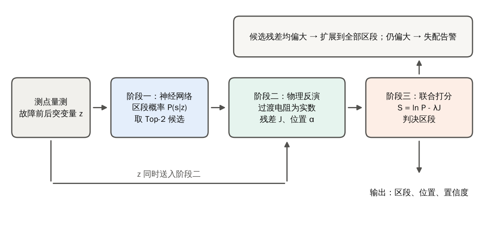
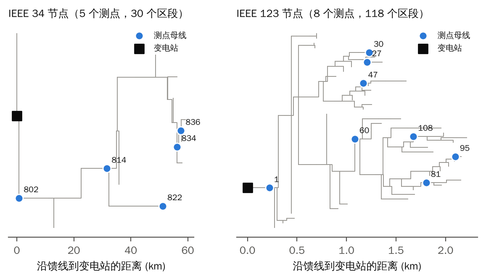
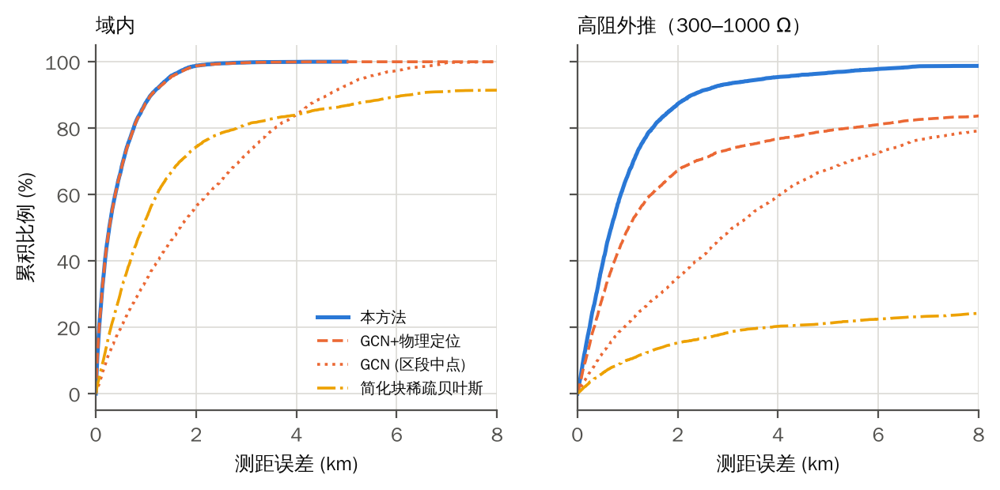
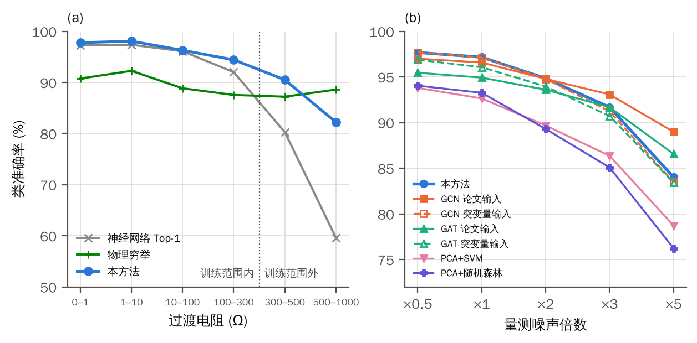

# 极稀疏量测下的配电网故障定位：数据驱动粗筛与物理闭环校正

*初稿（实验结果均来自 OpenDSS 仿真，未使用实测数据）*

## 摘要

配电网只有极少数同步量测点时，现有故障定位方法各有不足：数据驱动方法在测试条件偏离训练分布时精度下降，物理反演不受训练分布影响，但在响应相近的区段之间区分度不足。本文提出数据粗筛与物理闭环校正的两阶段方法：神经网络把故障区段缩小到两个候选，再用过渡电阻限定为实数的物理反演逐个核对并估计区段内位置，由贝叶斯联合打分合并两者的证据；候选都不能解释量测时扩大搜索范围，仍不能解释则发出失配告警。在 IEEE 34 节点（5 个测点、30 个区段）上，过渡电阻超出训练范围（300–1000 Ω）时本方法的区段准确率（按等价类判定）为 85.2%，对比的外部方法中最高的为 69.6%；同分布内与最强基线相当（本方法 97.0%，基线最高 97.1%）；把过渡电阻限定为实数使物理反演的区段准确率在全部 16 个场景提高 6.6–12.4 个百分点；在调压器档位固定的 4 个场景中比 Liang 等的两阶段方法高 10.9–26.7 个百分点。在 IEEE 123 节点（8 个测点、118 个区段）上，本方法在 5/7 个场景显著优于其余方法。线路阻抗存在偏差时，部分基线的区段准确率更高；逐线阻抗真值诊断表明位置误差的增加来自线路参数失配。全部结果来自仿真。

**关键词：** 故障定位；配电网；极稀疏量测；物理反演；数据驱动；分布外泛化

## 1 引言

配电网区段多、分支多，故障后依靠巡线定位耗时长，缩短定位时间是缩短停电时间的关键环节[1,2]。同步相量量测装置（μPMU 等）的成本使得实际能安装的测点远少于区段数，这就是“极稀疏量测”问题：IEEE 34 节点馈线只有 5 个测点覆盖 30 个区段，IEEE 123 节点只有 8 个测点覆盖 118 个区段。
现有方法大致分两类。物理方法利用网络模型，包括阻抗法[3,4]、电压凹陷与响应匹配[5,6]、稀疏恢复与压缩感知[7,8,9]，以及先筛选候选、再做非线性状态估计的两阶段方法[10]。它们不依赖训练数据，但测点很少时不同区段的响应相近，残差的区分度有限。数据驱动方法用神经网络学习量测到故障位置的映射，包括支持向量机和集成学习[11,12,13]、卷积网络[14,15]和图神经网络[16,17,18]，训练分布内精度很高，但测试条件偏离训练分布时精度会下降。在我们检索到的文献中，测试集的过渡电阻、负荷水平等通常与训练同分布，超出训练范围的外推测试很少见（见相关工作一节）。
这两类方法的失效条件不同：数据驱动方法在训练分布外失效，物理方法在响应相近的区段之间失效。本文据此提出“数据粗筛、物理校正”的两阶段方法：神经网络把候选区段缩小到两个，再用过渡电阻限定为实数的物理反演逐个核对并估计区段内位置，最后用贝叶斯联合打分合并两者的证据；两路证据都不能解释量测时扩大搜索范围，仍不能解释则发出失配告警。
本文的贡献：

1. 提出两阶段方法：神经网络从全部区段中选出 2 个候选，物理反演逐个核对，联合打分判决；候选都不能解释量测时扩大搜索，仍不能解释则发出失配告警。在 IEEE 34 过渡电阻 300–1000 Ω 时，类准确率从神经网络加物理定位的 68.5% 提高到 85.8%。
2. 在物理反演中把过渡电阻限定为实数，并引入带先验的实增益。IEEE 34 域内，物理穷举的类准确率从 82.7% 提高到 90.3%，在全部 16 个场景都提高。
3. 在 IEEE 34 与 IEEE 123 上与 4 个已发表方法和 2 个机器学习基线比较，覆盖过渡电阻、负荷、噪声外推，以及整体与逐线的线路参数偏差；给出本方法占优与不占优的场景，并用逐线阻抗真值诊断指出线路参数偏差下的损失来源。

## 2 相关工作

**物理方法。** 阻抗法由视在阻抗估计故障距离，对过渡电阻和负荷敏感[3]，同步相量与分布式电源下的扩展见[4]。电压凹陷方法借助阻抗矩阵与分块把方程化为可解形式[5]，也有先用分类器选支路、再用仿真库相似度匹配的做法[6]。稀疏量测方法把故障建模为稀疏的虚拟注入电流，用贝叶斯压缩感知或块稀疏贝叶斯学习求解，并讨论了最少测点数[7,8,9,19,20]；Jia 等在稀疏混合量测下进一步采用两阶段方法[21]。Liang 等的两阶段方法第一阶段用虚拟电流的线性模型匹配筛选可疑线路，第二阶段对候选做非线性故障状态估计并定位到线内[10]，与本文结构最接近；不同之处是其第一阶段不含学习先验，据其摘要未见神经网络概率与物理残差的联合打分，也未见扩大搜索后的失配告警。
**数据驱动方法。** 经典机器学习用电压电流特征训练 SVM、人工神经网络、随机森林或其堆叠[11,12,13,22]；深度学习包括卷积网络[14,15,23]和图网络。Chen 等用切比雪夫图卷积在 IEEE 123 节点上分类故障母线，并与 PCA+SVM、PCA+随机森林和全连接网络比较[16]；后续工作有图注意力网络[17]、时空图网络[18]、含边属性的图网络[24]和深度图学习[25]。Khattak 和 Choudhry 在改进的 IEEE 34 与 IEEE 123 节点上分别用 5 个和 9 个 PMU 的故障前后差值相量训练卷积网络[15]，测点数与本文相近，但其评测未含噪声、负荷偏移和超出训练范围的过渡电阻，也没有物理反演。
**物理与数据结合。** 已有工作把物理结构放进网络：Li 和 Deka 按物理结构构造邻接矩阵并分两个阶段学习嵌入与标签传播[26]；Zheng 等在图注意力网络的损失中加入基尔霍夫电流定律残差项[27]；Hu 等把物理网络结构作为训练约束[25]。这些方法中物理信息作用于训练或网络结构，推理时不求解物理反演，也没有基于残差的校验与告警。关于线路参数误差，Shan 等的摘要提到方法对线路参数误差具有抗性[20]，Yu 等用稳态数据先校正线路参数再定位[28]。低可观测条件下的理论工作指出，测点远少于可观性要求时只能把故障定位到子图而不是单条线路[29,30]，这与本文极稀疏设定下需要“候选加核对”的思路一致。
表 1 归纳了与本文最接近的方法。我们检索到的文献中，未见到把神经网络概率与物理残差联合打分、在候选残差都偏大时扩大搜索并发出失配告警、并系统测试过渡电阻超出训练范围的工作；这一判断基于摘要与部分全文，不能代替完整检索。

**表 1 与本文最接近的方法（据摘要与可得全文整理）**

| 方法 | 类别 | 输入与测点 | 推理时含物理模型 | 外推或偏离训练分布测试 | 失配告警 |
|:--|:--|:--|:--|:--|:--|
| 本文 | 神经网络加物理反演 | 相量突变量，5/8 个测点 | 是（过渡电阻为实数的约束反演） | 是 | 是 |
| Liang 等 2025[10] | 线性匹配筛选 + 非线性状态估计 | μPMU 相量，优化配置 | 是 | 未见 | 未见 |
| Jiang 等 2021[8] | 块稀疏贝叶斯学习 | 同步相量，IEEE 123 | 是 | 未见 | 否 |
| Khattak 和 Choudhry 2025[15] | 一维 CNN | 故障前后差值相量，IEEE 34/123 用 5/9 个 PMU | 否 | 未见（无噪声、无负荷偏移，Rf ≤ 10 Ω） | 否 |
| Chen 等 2019[16] | 图卷积网络 | 故障期间相量，IEEE 123 默认 25 个测点 | 否 | 负荷水平、噪声、拓扑变化 | 否 |
| Li 和 Deka 2023[26] | 物理结构图网络 | 相量，IEEE 123 的 21 个测点 | 否（结构含物理信息） | 负荷与拓扑变化 | 否 |
| Zheng 等 2026[27] | 双图物理信息图注意力网络 | IEEE 33 | 否（KCL 残差为训练正则项） | 噪声、数据缺失 | 否 |

## 3 方法

### 3.1 量测模型与总体流程

设测点共有 $m$ 个复数量测（各测点母线的三相电压和一条相连线路的三相电流），故障前后的相量之差记为突变量 $\mathbf z\in\mathbb C^{m}$。网络线性化后，位置为 $(s,\alpha)$（区段 $s$，区段内位置 $\alpha\in(0,1)$）、故障相集合为 $\tau$ 的故障，其突变量满足 $\mathbf z=\mathbf G_{\tau}(s,\alpha)\,\mathbf i+\mathbf n$，其中 $\mathbf G_{\tau}(s,\alpha)$ 是故障相单位注入电流的响应（由节点导纳矩阵求得），$\mathbf i$ 为注入电流，$\mathbf n$ 为量测噪声。方法分三阶段：阶段一用神经网络给出区段后验概率并取前 $k=2$ 个候选；阶段二对每个候选做物理反演，得到加权残差 $J$ 和区段内位置；阶段三联合两者判决，并在必要时扩大候选集或发出告警（图 1）。

*图 1 方法框图。神经网络从全部区段中选出 Top-2 候选，物理反演逐个核对并估计区段内位置，联合打分判决；候选残差都偏大时扩展到全部区段，仍偏大则发出失配告警。*

### 3.2 阶段一：区段后验概率

故障电流的复幅值未知，所以特征取各分量与幅值最大的分量之比 $\mathbf u=\mathbf z/z_{\mathrm{ref}}$ 的实部与虚部，另附各分量的对数信噪比 $\log_{10}(|z_i|/\sigma_i)$ 和参考分量的对数信噪比，共 $3m+1$ 维。分类器是全连接网络（IEEE 34 为 160-160-96，IEEE 123 为 256-256-192），输出各区段的 softmax 概率 $P(s\mid\mathbf z)$。训练时每个批次重新叠加量测噪声；训练集除名义线路阻抗的样本外，加入线路阻抗倍率为 0.88、0.94、1.06、1.12 的样本，使网络对线路参数的整体偏差不过度敏感。
### 3.3 阶段二：过渡电阻为实数的约束物理反演

若注入电流 $\mathbf i$ 取自由复数，每个区段多出一个复自由度，在测点很少时足以拟合其他区段的响应，区段之间的残差差距因此缩小。实际上故障电流由过渡电阻 $R$（实数）和故障点自身阻抗决定。设故障点故障前电压为 $\mathbf V_{f}^{\mathrm{pre}}$，故障点自身阻抗矩阵为 $\mathbf Z_{ff}$，$\mathbf E$ 为故障相的连接矩阵，则故障电流为 $\mathbf i_f(R)=(R\mathbf E+\mathbf Z_{ff})^{-1}\mathbf V_f^{\mathrm{pre}}$，注入电流 $\mathbf i=-\mathbf i_f$（相间故障取相应的差分形式）。再引入实数增益 $g$ 吸收故障前电压相对名义值的偏差，其先验为 $g\sim\mathcal N(1,\sigma_g^2)$（$\sigma_g=0.05$），于是
$$J(s,\alpha,R,g)=\big\|\mathbf W^{1/2}\big(\mathbf z-g\,\mathbf G_{\tau}(s,\alpha)\,\mathbf i(R)\big)\big\|^{2}+\Big(\frac{g-1}{\sigma_g}\Big)^{2},\qquad W_{ii}=\frac{1}{\sigma_i^{2}+(\varepsilon_r|z_i|)^{2}+(\varepsilon_a z_{\max})^{2}}$$

权重中的 $\varepsilon_r=2\%$、$\varepsilon_a=1\%$ 表示线性化的模型误差，$z_{\max}$ 为同类量测的最大幅值。对每个候选区段，在 49 个等间隔位置 $\alpha\in[0.02,0.98]$ 与 48 点对数网格 $R\in[0.01,3000]\,\Omega$ 上求 $J$（$g$ 有闭式解），再在最优点附近以 13 点细搜 $R$；对线路阻抗 0.9、0.95、1.0、1.05、1.1 倍的五个假设各算一遍，惩罚残差为 $J_{\mathrm{pen}}=J+((s_z-1)/0.05)^2$（$s_z$ 为阻抗倍率），取最小者；报告的残差 $J$ 不含这一先验项。输出为 $J_{\mathrm{pen}}$、$J$ 与位置估计 $\hat\alpha$、故障类型。
### 3.4 阶段三：联合打分、候选扩展与告警

候选区段的得分为 $S_s=\ln P(s\mid\mathbf z)-\lambda\,J_{\mathrm{pen}}(s)$，取得分最大的候选；$\lambda$ 在验证集上最大化真实等价类的联合后验似然得到。设 $\theta$ 为假设正确时残差 $J$ 的 99% 分位数（验证集上标定）：若两个候选的 $J$ 都大于 $\theta$，说明阶段一的候选集不可信，把候选扩展到全部区段重新打分；扩展后最小的 $J$ 仍大于 $\theta$，则标记模型失配告警。置信度取候选池内 $\mathrm{softmax}(S)$ 在所选区段所属等价类上的概率。等价类由物理证据定义：真实故障在 $s$ 时，若不少于一半的样本中区段 $s'$ 的惩罚残差不比 $s$ 大出 4，则两者互相不可区分，双向不可区分的区段连通成一类。
## 4 实验设置

### 4.1 系统、测点与数据

测试系统为 IEEE 34 节点馈线（30 个故障区段）和 IEEE 123 节点馈线（118 个故障区段，开关作为短连接线），仿真用 OpenDSS[31]。IEEE 34 的 5 个测点位于母线 814、836、802、822、834，IEEE 123 的 8 个测点位于母线 60、47、95、1、108、27、81、30（图 2）；测点按物理穷举的平均测距误差贪心前向选取。每个测点量测母线的三相电压和一条相连线路的三相电流，IEEE 34 共 26 个复数量测，IEEE 123 共 44 个。量测噪声：电压为名义电压的 0.1%，电流为 0.2 A，突变量为两次量测之差，噪声标准差再乘 $\sqrt2$。故障共 10 种类型（单相接地、相间、两相接地、三相接地），位置沿全网均匀，过渡电阻在训练集中对数均匀取 0.01–300 Ω，负荷倍率取 0.6–1.1。训练集 IEEE 34 为 8 万个名义阻抗样本加线路阻抗倍率 0.88、0.94、1.06、1.12 各 2 万个，IEEE 123 为 12 万个加各 3 万个；每个测试场景 5000 个样本。

*图 2 测试系统的拓扑（以变电站为根、横轴为沿馈线到变电站的距离）与测点位置。*

### 4.2 测试场景

所有场景使用同一个训练好的模型，只改变测试条件。“域内”与训练同分布。外推与鲁棒性场景为：负荷偏移（全网负荷 1.25–1.5 倍，超出训练的 0.6–1.1）；高阻外推（过渡电阻 300–1000 Ω，超出训练的 0.01–300 Ω）；噪声 ×3（量测噪声放大 3 倍）；线路阻抗 ±10%（全网线路阻抗整体偏大或偏小，模型仍用名义值）；个别线路阻抗 ±20%（每条线路阻抗独立取名义值的 0.8–1.2 倍）。噪声敏感性取 ×0.5、×1、×2、×3、×5。为与要求调压器档位已知的 Liang 两阶段方法比较，另有调压器档位固定的域内、负荷偏移、高阻外推、噪声 ×3 四个场景（各 3000 样本）。表 2 列出各场景的作用。
**表 2 测试场景及其作用**

| 场景 | 设置 | 作用 |
|:--|:--|:--|
| 域内 | 与训练同分布 | 同分布内的总体与分档精度 |
| 负荷偏移 | 全网负荷 1.25–1.5 倍（训练 0.6–1.1） | 负荷水平外推 |
| 高阻外推 | 过渡电阻 300–1000 Ω（训练 0.01–300 Ω） | 数据驱动失效处的表现 |
| 噪声×3 | 量测噪声放大 3 倍 | 噪声鲁棒性 |
| 线路阻抗+10% / 线路阻抗-10% | 全网线路阻抗整体偏差，模型仍用名义值 | 线路参数不准 |
| 个别线路阻抗±20% | 每条线路阻抗独立取名义值的 0.8–1.2 倍 | 更接近实际的模型误差 |
| 固定档位（4 个） | 调压器档位固定的域内、负荷偏移、高阻外推、噪声×3 | 与要求档位已知的 Liang 两阶段方法比较 |
| 噪声档位 | 噪声 ×0.5、×1、×2、×3、×5 | 噪声敏感性 |

### 4.3 对比方法

共 6 个外部方法，其中 4 个为已发表方法，2 个为机器学习基线，均在相同的训练集上训练、使用相同的量测。已发表方法：（1）GCN[16]，切比雪夫图卷积，输入有“论文输入”（故障期间相量的幅值与相角）和“突变量输入”（与阶段一相同的特征）两种；（2）GAT[17]，3 层 4 头图注意力，注意力限于物理相邻母线，两种输入同 GCN；（3）块稀疏贝叶斯学习[8]，以各候选位置的三相虚拟注入电流为未知量，用 EM 迭代估计块方差，取能量最大的块；位置受 10 点 $\alpha$ 网格限制，不使用神经网络，线路参数取名义值；（4）Liang 两阶段方法[10]，线性模型匹配筛选加非线性故障状态估计，假设调压器档位与网络参数精确已知，因此只在档位固定的场景比较，并获得多于本方法的量测（根母线相量、末端电压幅值、全网负荷伪量测）。机器学习基线：（5）PCA+SVM 和（6）PCA+随机森林，沿用 Chen 等的对照协议[16]，输入为阶段一的特征，标准化后做 PCA（保留 99% 方差）；SVM 为 RBF 核，受核方法计算量限制只用 3 万个训练子样本。除 Liang 两阶段方法和块稀疏贝叶斯学习外，所有分类器都只输出区段，故障点取预测区段中点；我们另外把每个分类器的 Top-1 区段交给阶段二估计区段内位置（记作“+物理定位”），或把它的概率作为阶段一接入完整流程（记作“+本方法流程”），以分开评价区段选择与位置估计。内部对照还有神经网络 Top-1 加物理定位（硬串联）、全区段物理穷举、已知区段的 Oracle。所有基线均为我们按原文复现，与原作者的实现可能有差异，详见附录表 A6。
### 4.4 评价指标与统计

区段准确率按等价类判定（IEEE 34 为 22 类，IEEE 123 为 64 类；等价类由物理证据定义并固定，使不同方法同口径），同时报告精确区段准确率。测距误差为预测故障点与真实故障点沿馈线到变电站的距离之差的绝对值（km），报告均值，必要时报告中位数、P90 与分位数。纠错率 CR 与误改率 FCR 以阶段一 Top-1 的对错为参照。神经网络训练的随机性用多个种子衡量：IEEE 34 上本方法与 GCN 为 5 个种子，GAT 与 PCA 基线为 3 个种子；块稀疏贝叶斯没有随机性，Liang 两阶段为单次结果；IEEE 123 上本方法 5 个种子、GCN 3 个种子，其余基线为单次结果；报告均值±标准差，均值差超过两者较大标准差的 2 倍才称为显著。
## 5 结果

### 5.1 与已发表方法和机器学习基线的对比

**表 3 IEEE 34 上的主对比：类准确率（%，均值±标准差）与测距误差（km）。每行最优加粗**

| 场景 | 本方法 | GCN（论文输入） | GCN（突变量输入） | GAT（论文输入） | GAT（突变量输入） | 块稀疏贝叶斯 | PCA+SVM | PCA+随机森林 |
|:--|---:|---:|---:|---:|---:|---:|---:|---:|
| 域内 | 97.0±0.1 | 96.6±0.1 | **97.1±0.0** | 94.9±0.1 | 96.1±0.1 | 79.0 | 92.7±0.1 | 93.2±0.1 |
| 负荷偏移 | **94.6±0.3** | 88.4±1.0 | 93.5±0.6 | 91.4±1.0 | 92.2±0.6 | 78.5 | 87.8±0.3 | 86.8±0.3 |
| 高阻外推 | **85.2±0.4** | 42.6±0.8 | 66.8±4.2 | 43.8±1.4 | 69.6±0.8 | 15.7 | 54.4±0.3 | 43.4±0.4 |
| 噪声×3 | 92.4±0.4 | **92.9±0.2** | 91.5±0.3 | 91.4±0.1 | 90.9±0.3 | 47.3 | 86.6±0.3 | 85.0±0.2 |
| 线路阻抗+10% | 95.1±0.1 | 95.7±0.1 | **96.5±0.0** | 93.8±0.1 | 95.4±0.3 | 76.8 | 91.1±0.1 | 90.5±0.1 |
| 线路阻抗-10% | 94.1±0.3 | 95.6±0.1 | **96.7±0.1** | 92.9±0.2 | 95.4±0.1 | 71.4 | 89.0±0.2 | 88.7±0.1 |
| 个别线路阻抗±20% | 89.9±0.1 | **90.4±0.2** | 88.3±0.1 | 90.2±0.1 | 89.0±0.1 | 75.2 | 88.3±0.2 | 88.4±0.2 |
| **测距误差 (km)**：分类器为“区段中点 / +物理定位” |  |  |  |  |  |  |  |  |
| 域内 | **0.44** | 2.12 / 0.45 | 2.08 / **0.44** | 2.22 / 0.51 | 2.11 / 0.46 | 4.95 | 2.29 / 0.52 | 2.26 / 0.50 |
| 负荷偏移 | **0.64** | 2.70 / 1.19 | 2.12 / 0.66 | 2.55 / 0.95 | 2.21 / 0.65 | 4.43 | 2.62 / 0.97 | 2.80 / 1.02 |
| 高阻外推 | **1.36** | 9.91 / 8.35 | 5.97 / 4.67 | 10.71 / 9.15 | 5.06 / 3.63 | 28.07 | 7.54 / 5.76 | 8.98 / 7.14 |
| 噪声×3 | **0.53** | 2.36 / 0.67 | 2.44 / 0.68 | 2.41 / 0.64 | 2.47 / 0.76 | 19.30 | 2.79 / 0.89 | 2.94 / 1.02 |
| 线路阻抗+10% | **0.73** | 2.17 / 0.77 | 2.08 / **0.73** | 2.23 / 0.79 | 2.11 / 0.74 | 5.00 | 2.30 / 0.82 | 2.33 / 0.84 |
| 线路阻抗-10% | 0.84 | 2.18 / 0.84 | 2.10 / **0.80** | 2.33 / 0.91 | 2.13 / 0.82 | 6.15 | 2.50 / 0.96 | 2.42 / 0.92 |
| 个别线路阻抗±20% | **0.98** | 2.32 / 0.99 | 2.35 / 1.02 | 2.37 / 1.01 | 2.33 / 0.99 | 5.74 | 2.47 / 1.02 | 2.42 / 1.00 |

表 3 给出主对比。与每个场景中均值最高的其余方法相比，本方法在 1 个场景显著更高（高阻外推），3 个场景无显著差别（域内、负荷偏移、噪声×3），3 个场景显著更低（线路阻抗+10%、线路阻抗-10%、个别线路阻抗±20%）。

过渡电阻超出训练范围（300–1000 Ω）时差距最大：本方法 85.2%，其余方法中最高的 GAT（突变量输入） 为 69.6%。域内本方法为 97.0%，与最强的基线（GCN（突变量输入），97.1%）相差 0.1 个百分点。

在线路阻抗偏差场景中（线路阻抗+10%、线路阻抗-10%、个别线路阻抗±20%），本方法低于GCN（突变量输入）、GCN（论文输入），差距 0.5–2.6 个百分点：这些场景使阶段二的名义响应库失配，区段判别主要依赖阶段一，而基线与阶段一使用相同的训练数据。

分类器基线只输出区段，故障点取预测区段中点，测距误差因此明显偏大；把它们的 Top-1 区段交给阶段二估计区段内位置（“+物理定位”）后，测距误差与本方法接近，说明区段内测距精度主要来自物理反演（表 3 下半部分，图 4）。块稀疏贝叶斯学习自带位置估计，但受 α 网格限制且对过渡电阻没有约束。

*图 4 IEEE 34 上测距误差的累积分布：(左) 域内，(右) 高阻外推。*

*图 5 IEEE 34 外推与参数偏差场景下各方法的类准确率（均值，误差线为标准差；GCN、GAT 取每个场景准确率较高的输入）。*

**表 4 档位固定场景下与 Liang 两阶段方法的比较（类准确率 %；Liang 取四个变体中最好者）**

| 场景 | 本方法 | Liang 两阶段 | GCN（论文输入） | GCN（突变量输入） | GAT（论文输入） | GAT（突变量输入） | 块稀疏贝叶斯 | PCA+SVM | PCA+随机森林 |
|:--|---:|---:|---:|---:|---:|---:|---:|---:|---:|
| 固定档位 域内 | **94.5±0.1** | 81.3 | 93.6±0.3 | 91.3±0.2 | 87.0±0.5 | 91.7±0.2 | 78.6 | 90.4±0.4 | 90.4±0.1 |
| 固定档位 负荷偏移 | **92.1±0.2** | 81.0 | 85.5±1.6 | 84.0±1.0 | 79.0±0.6 | 81.6±0.6 | 79.1 | 85.5±1.2 | 88.0±0.1 |
| 固定档位 高阻外推 | **85.3±0.5** | 58.7 | 37.6±0.9 | 64.7±4.1 | 30.0±2.5 | 69.0±1.1 | 15.4 | 51.9±0.3 | 41.4±0.3 |
| 固定档位 噪声×3 | **92.0±0.3** | 78.1 | 90.2±0.4 | 88.0±0.3 | 84.2±0.4 | 87.9±0.3 | 47.2 | 84.7±0.8 | 81.9±0.2 |

测距误差（均值）：固定档位 域内: 本方法 0.45 km, Liang 0.91 km; 固定档位 负荷偏移: 本方法 0.63 km, Liang 1.02 km; 固定档位 高阻外推: 本方法 1.28 km, Liang 4.36 km; 固定档位 噪声×3: 本方法 0.51 km, Liang 1.36 km.

### 5.2 同分布内的分档精度

**表 5 IEEE 34 同分布内（Rf ≤ 300 Ω）及高阻外推样本按故障类型、故障位置、过渡电阻分档的类准确率（%，种子 0；Rf 300 Ω 以上的两档取自高阻外推场景）**

| 分组 | 样本数 | 本方法 | GCN（论文输入） | GCN（突变量输入） | GAT（论文输入） | GAT（突变量输入） | 块稀疏贝叶斯 | PCA+SVM | PCA+随机森林 |
|:--|---:|---:|---:|---:|---:|---:|---:|---:|---:|
| 故障类型 SLG | 2677 | 97.1 | 96.5 | **97.3** | 94.6 | 95.8 | 77.5 | 92.0 | 92.1 |
| 故障类型 LL | 1030 | **97.1** | 96.6 | 96.6 | 94.4 | 96.0 | 81.9 | 93.8 | 95.2 |
| 故障类型 LLG | 962 | **97.5** | 97.1 | 97.3 | 96.0 | 96.7 | 79.3 | 92.9 | 93.5 |
| 故障类型 LLLG | 331 | **96.7** | 95.5 | **96.7** | 95.8 | 96.4 | 80.4 | 93.4 | 96.1 |
| 位置 近端（α<0.35） | 1730 | **96.4** | 96.0 | 96.2 | 94.4 | 95.3 | 73.3 | 91.7 | 91.8 |
| 位置 中段（0.35≤α<0.65） | 1591 | 99.1 | 98.1 | **99.2** | 97.3 | 98.7 | 81.8 | 95.5 | 96.0 |
| 位置 远端（α≥0.65） | 1679 | **96.1** | 95.7 | **96.1** | 93.2 | 94.3 | 82.1 | 90.9 | 92.2 |
| Rf 0–1 Ω | 2249 | 97.8 | **98.6** | 97.9 | 97.6 | 97.0 | 84.3 | 93.3 | 95.6 |
| Rf 1–10 Ω | 1137 | **98.1** | 97.9 | 98.0 | 97.2 | 97.9 | 84.9 | 94.8 | 95.5 |
| Rf 10–100 Ω | 1076 | **96.3** | 94.4 | 96.2 | 92.0 | 94.7 | 78.6 | 91.9 | 90.5 |
| Rf 100–300 Ω | 538 | **94.4** | 89.6 | 93.9 | 84.9 | 90.9 | 44.6 | 86.6 | 84.2 |
| Rf 300–500 Ω | 2149 | **90.5** | 69.6 | 86.5 | 66.5 | 81.8 | 22.0 | 69.6 | 62.4 |
| Rf 500–1000 Ω | 2851 | **82.2** | 22.9 | 48.2 | 26.9 | 61.1 | 11.0 | 43.6 | 30.8 |

各类故障的类准确率在 96.7%–97.5% 之间，近端、中段、远端在 96.1%–99.1% 之间，说明方法对故障类型与区段内位置都没有明显的短板。按过渡电阻分档，准确率随过渡电阻升高而下降，并在超出训练范围后下降明显。在 13 个分档中，本方法在 10 个分档上最高。

### 5.3 数据驱动与物理反演的互补

*图 3 (a) IEEE 34 上类准确率随过渡电阻的变化（域内为 0.01–300 Ω，高阻外推为 300–1000 Ω，虚线右侧超出训练范围）；(b) 类准确率随量测噪声倍数的变化（GCN、GAT 的论文输入为实线、突变量输入为虚线；块稀疏贝叶斯学习从 ×3 起低于 50%，未画出）。*

图 3(a) 是本文方法动机的直接证据：神经网络的类准确率随过渡电阻升高而下降（97.2% → 92.0% → 80.3% → 59.6%，依次为 0–1 Ω、100–300 Ω、300–500 Ω、500–1000 Ω），物理穷举基本不随过渡电阻变化（87.2%–92.3%）但在低阻时低于神经网络；两条曲线在 300–500 Ω 附近交叉，联合决策在该区间（90.5%）高于两者。500–1000 Ω 时联合决策（82.2%）仍低于物理穷举（88.6%），原因是 Top-2 候选漏掉了真实区段。

图 3(b) 为量测噪声敏感性：噪声倍数 ×0.5、×1、×2 时本方法是各方法中最高或并列最高；×3 时 GCN（论文输入） 高 1.4 个百分点；×5 时 GCN（论文输入） 高 5.0 个百分点。神经网络加物理定位的硬串联在噪声升高时下降更快（×5 时 75.2%，本方法 84.0%）。

表 7b 显示两者的错误并不重合：神经网络错时物理穷举对的比例，域内为 60%，高阻外推为 82%；物理穷举错时神经网络对的比例，域内为 86%，高阻外推为 54%。这支持联合决策的前提；但它不单独证明神经网络下降的原因是特征越出训练范围，间接依据是 GCN 论文输入（故障期间的绝对相量）在高阻外推下下降更多。

### 5.4 物理模型的消融

**表 6 物理模型的受控消融（IEEE 34，种子 0；自由：注入电流为自由复数；约束：过渡电阻为实数加实增益；无增益：约束但增益固定为 1）。除物理模型外其余设置相同**

| 场景 | 物理穷举 自由 | 物理穷举 约束 | 物理穷举 无增益 | 联合决策 自由 | 联合决策 约束 | 联合决策 无增益 | 测距误差 km 自由 | 测距误差 km 约束 | 测距误差 km 无增益 |
|:--|---:|---:|---:|---:|---:|---:|---:|---:|---:|
| 域内 | 82.7 | 90.3 | **90.4** | 96.8 | **97.2** | 97.0 | 0.57 | **0.43** | 0.54 |
| 负荷偏移 | 82.5 | **90.7** | 90.3 | 93.4 | **94.2** | 93.6 | **0.62** | 0.65 | 0.95 |
| 高阻外推 | 79.2 | **88.0** | 82.7 | 80.3 | **85.8** | 83.3 | 1.56 | **1.39** | 1.73 |
| 噪声×3 | 82.3 | 89.8 | **90.4** | 88.7 | **91.7** | 91.6 | 0.74 | **0.54** | 0.62 |
| 线路阻抗-10% | 77.3 | 83.8 | **85.2** | **94.3** | 94.0 | 94.1 | 1.01 | **0.84** | 0.97 |
| 固定档位 域内 | 85.1 | **93.3** | 89.9 | 93.6 | **94.5** | 94.0 | 0.56 | **0.45** | 0.73 |
| 固定档位 负荷偏移 | 81.4 | **93.9** | 90.1 | 87.7 | 91.9 | **92.6** | 0.72 | **0.63** | 1.07 |
| 固定档位 阻抗+10% | 82.7 | **89.6** | 88.7 | 91.6 | 91.5 | **92.3** | 0.92 | **0.82** | 0.99 |

把过渡电阻限定为实数后，物理穷举的类准确率在全部 16 个场景都提高，提高 6.6–12.4 个百分点；联合决策在 13 个场景提高，测距误差在 15 个场景降低。实增益在故障前电压偏离名义值较多的场景作用明显：高阻外推与固定档位场景下，去掉增益使物理穷举降低 0.9–5.3 个百分点；但增益对联合决策类准确率的影响不一致，其收益主要体现在物理穷举与测距误差上。线路阻抗整体偏差 ±10% 的场景下，约束对联合决策没有增益。

### 5.5 阶段一换成其他分类器

**表 7 各分类器作为阶段一接入本方法流程（IEEE 34，种子 0；类准确率 %）**

| 分类器 | 域内: 自身 → +本方法流程 | 高阻外推: 自身 → +本方法流程 | 噪声×3: 自身 → +本方法流程 | 线路阻抗-10%: 自身 → +本方法流程 | +本方法流程高于+物理定位的主场景数（共 7 个） |
|:--|---:|---:|---:|---:|---:|
| GCN（论文输入） | 96.6 → 97.5 | 43.0 → 83.6 | 93.1 → 95.5 | 95.3 → 95.9 | 7 |
| GCN（突变量输入） | 97.2 → 97.3 | 64.2 → 84.3 | 91.8 → 94.1 | 96.8 → 96.4 | 5 |
| GAT（论文输入） | 94.9 → 96.8 | 43.9 → 82.8 | 91.7 → 95.3 | 92.8 → 93.3 | 7 |
| GAT（突变量输入） | 95.9 → 96.9 | 69.5 → 89.1 | 90.3 → 94.2 | 95.4 → 95.0 | 5 |
| PCA+SVM | 92.6 → 94.3 | 54.8 → 78.0 | 86.4 → 92.3 | 88.5 → 89.2 | 7 |
| PCA+随机森林 | 93.3 → 95.6 | 44.4 → 80.7 | 85.1 → 93.3 | 88.5 → 89.9 | 7 |

**表 7b 神经网络 Top-1 与全区段物理穷举的对错互补（占全部样本的百分比，IEEE 34，种子 0）**

| 场景 | 两者都对 | 仅神经网络对 | 仅物理对 | 两者都错 | 神经网络错时物理对 (%) | 物理错时神经网络对 (%) |
|:--|---:|---:|---:|---:|---:|---:|
| 域内 | 88.2 | 8.3 | 2.1 | 1.4 | 60 | 86 |
| 负荷偏移 | 86.2 | 6.3 | 4.5 | 3.0 | 60 | 68 |
| 高阻外推 | 62.0 | 6.4 | 26.0 | 5.6 | 82 | 54 |
| 噪声×3 | 80.6 | 6.6 | 9.2 | 3.6 | 72 | 65 |
| 线路阻抗-10% | 81.8 | 12.7 | 2.1 | 3.4 | 37 | 79 |
| 个别线路阻抗±20% | 81.3 | 8.1 | 3.9 | 6.7 | 37 | 55 |
| 固定档位 负荷偏移 | 84.8 | 2.2 | 9.0 | 3.9 | 70 | 36 |
| 固定档位 高阻外推 | 62.8 | 5.5 | 25.6 | 6.2 | 80 | 47 |

把 GCN、GAT、PCA+SVM、PCA+随机森林的概率作为阶段一接入本方法流程后，联合打分与候选扩展相对“分类器 + 物理定位”在 7 个主场景中分别有 7、5、7、5、7、7 个提高（依次为 GCN 论文输入、GCN 突变量输入、GAT 论文输入、GAT 突变量输入、PCA+SVM、PCA+随机森林），说明流程的增益不依赖具体的阶段一网络。阶段一的网络与输入仍影响最终结果，见表 7 与表 3。

在 7 个主场景中，用本方法流程时准确率最高的阶段一依次为：GCN（论文输入）（2 个）、GAT（突变量输入）（2 个）、GCN（突变量输入）（2 个）、GAT（论文输入）（1 个）。默认的 MLP 阶段一并不是每个场景下最强的，这是流程与阶段一网络解耦的另一个含义：换用更强或更适合某类场景的阶段一，流程仍然适用。

### 5.6 模型偏差下的表现与损失来源

**表 8 模型偏差场景（IEEE 34，类准确率 %）**

| 场景 | 本方法 | GCN（论文输入） | GCN（突变量输入） | GAT（论文输入） | GAT（突变量输入） | 块稀疏贝叶斯 | PCA+SVM | PCA+随机森林 |
|:--|---:|---:|---:|---:|---:|---:|---:|---:|
| 个别线路阻抗±20% | 89.9±0.1 | **90.4±0.2** | 88.3±0.1 | 90.2±0.1 | 89.0±0.1 | 75.2 | 88.3±0.2 | 88.4±0.2 |
| 线路与负荷同时偏差 | **89.5±0.1** | 89.3±0.2 | 87.8±0.1 | 88.9±0.3 | 88.7±0.3 | 74.4 | 87.3±0.4 | 87.4±0.2 |
| 各负荷独立变化 | **97.3±0.1** | 96.1±0.2 | 97.1±0.2 | 94.2±0.1 | 96.4±0.2 | 80.0 | 92.7±0.2 | 92.3±0.4 |

**表 8b 个别线路阻抗 ±20% 下的逐线阻抗真值诊断（前 2500 个样本；神经网络 Top-1 为 89.2%）**

| 指标 | 名义阻抗模型（本方法） | 逐线真值模型 |
|:--|---:|---:|
| 联合决策类准确率 (%) | 89.7 | **92.7** |
| 区段已知时测距误差均值 (km) | 0.82 | **0.42** |
| 区段已知时测距误差中位数 (km) | 0.59 | **0.23** |

每条线路阻抗独立偏差 ±20% 时，本方法的类准确率从域内的 97.0% 降到 89.9%。表 8b 的诊断把每个样本真实的逐线阻抗交给阶段二：区段已知时的测距误差从 0.82 km 降到 0.42 km，回到无偏差时的水平，说明位置误差的增加来自模型失配；联合决策的类准确率只从 89.7% 回升到 92.7%，说明区段判别的损失还有阶段一在逐线偏差下的失配，不能全部归于物理模型。以同样的偏差分布扩增阶段一训练集只提高 0.6 个百分点（IEEE 34）和 1.4 个百分点（IEEE 123）。各负荷功率独立变化对结果没有影响（表 A5）。

### 5.7 IEEE 123 节点与计算耗时

**表 9 IEEE 123 上的对比（类准确率 %；块稀疏贝叶斯每个场景取 1000 个样本；GAT 论文输入因训练耗时未在 IEEE 123 上运行；本方法 5 个种子，GCN 3 个种子（个别线路阻抗 ±20% 为 2 个），其余为种子 0）**

| 场景 | 本方法 | GCN（论文输入） | GCN（突变量输入） | GAT（论文输入） | GAT（突变量输入） | 块稀疏贝叶斯 | PCA+SVM | PCA+随机森林 |
|:--|---:|---:|---:|---:|---:|---:|---:|---:|
| 域内 | **87.4±0.2** | 82.5±0.3 | 85.8±0.3 | - | 85.0 | 22.3 | 70.7 | 81.9 |
| 负荷偏移 | **87.5±0.3** | 69.2±1.5 | 85.4±0.3 | - | 83.7 | 23.3 | 71.9 | 80.3 |
| 高阻外推 | **39.0±0.8** | 15.5±0.1 | 22.6±0.6 | - | 18.5 | 0.7 | 2.6 | 12.3 |
| 噪声×3 | **75.9±0.2** | 69.5±1.5 | 75.4±0.3 | - | 75.2 | 6.5 | 61.6 | 70.8 |
| 线路阻抗+10% | **86.8±0.2** | 82.8±0.3 | 85.3±0.3 | - | 83.7 | 4.8 | 71.4 | 80.8 |
| 线路阻抗-10% | **85.9±0.2** | 81.4±0.2 | 84.2±0.0 | - | 83.0 | 3.9 | 69.0 | 78.5 |
| 个别线路阻抗±20% | 82.3±0.4 | 80.6±0.6 | **85.1±0.4** | - | 84.5 | 7.9 | 71.5 | 80.4 |

**表 9b 推断耗时（批量 1000 个样本，4 核 CPU 单进程）**

| 系统 | 阶段一 (ms/样本) | 阶段二，Top-2 候选 (ms/样本) | 全区段物理穷举 (ms/样本) |
|:--|---:|---:|---:|
| IEEE 34 | 0.003 | 8.2 | 181 |
| IEEE 123 | 0.008 | 3.9 | 337 |

IEEE 123 上（118 个区段、8 个测点），本方法在 5 个场景显著更高（域内、负荷偏移、高阻外推、线路阻抗+10%、线路阻抗-10%），1 个场景无显著差别（噪声×3），1 个场景显著更低（个别线路阻抗±20%）。高阻外推下所有方法都低，该场景的故障信号接近噪声。计算量方面，阶段二只对 2 个候选做物理反演，IEEE 34 为 8.2 ms/样本，全区段物理穷举为 181 ms；IEEE 123 为 3.9 ms 与 337 ms（批量 1000 个样本、4 核 CPU 单进程，与其他任务并行时测得，偏保守）。

## 6 讨论与局限

**方法的适用范围。** 本方法的增益集中在数据驱动方法失效的条件，即过渡电阻等超出训练范围的外推；在同分布内与最强的数据驱动基线相当，在线路阻抗存在偏差的场景中部分基线更高。因此它适合用在量测很少、故障条件可能超出训练覆盖范围、而线路参数相对可靠的配电网；若线路参数本身不准，则需要先做参数辨识，或像逐线真值诊断那样提供更准确的参数。
**局限。** （1）全部结果来自 OpenDSS 仿真，量测噪声与同步误差按假设取值，没有实测故障数据，仿真到现场的差距只能由模型偏差场景间接刻画。（2）区段准确率按固定的等价类判定，报告的精确区段准确率比它低约 2.5–3.3 个百分点（表 A2），但各方法的排序基本不变。（3）基线是我们按原文描述的复现，可能与原作者的实现有差异；Liang 两阶段方法在其论文的 IEEE 33 节点系统上复现的第一阶段低于论文报告（表 A3），对它的比较只代表复现版本；块稀疏贝叶斯的位置受网格限制，SVM 只用了 3 万个训练子样本。（4）过渡电阻 500–1000 Ω 时联合决策仍低于物理穷举，因为 Top-2 候选漏掉真实区段；IEEE 123 上高阻故障的信号接近噪声，所有方法的准确率都低。（5）没有覆盖分布式电源接入、拓扑重构、数据缺失和小电流接地系统；测点数量的影响也没有系统测试。（6）神经网络下降的原因（特征越出训练范围）只有间接证据。（7）默认的轻量 MLP 阶段一在各场景下并不总是最强（表 7 与 5.5 节），本文没有针对阶段一做进一步的选择或集成。
## 7 结论

本文针对极稀疏量测下的配电网故障定位，提出神经网络粗筛、物理反演校正、贝叶斯联合打分的两阶段方法，并加入候选扩展与失配告警。在 IEEE 34 与 IEEE 123 的仿真中，过渡电阻超出训练范围时本方法的区段准确率明显高于对比的数据驱动、稀疏恢复与两阶段方法（IEEE 34 为 85.2%，对比方法中最高 69.6%），同分布内与最强基线相当；区段内的测距精度来自物理反演，把过渡电阻限定为实数使物理反演的区段准确率在全部 16 个场景提高 6.6–12.4 个百分点。方法的主要局限是线路阻抗存在偏差时部分基线更高，以及没有实测验证。后续工作包括线路参数辨识与方法的联合、拓扑变化与分布式电源、以及实测数据验证。
## 数据与代码可用性

仿真基于公开的 OpenDSS IEEE 34 与 IEEE 123 节点算例；仿真程序、生成的数据集与全部实验脚本在项目代码库中，可向作者索取。

## 附录

**表 A1 超参数汇总**

| 模块 | 项目 | 取值 |
|:--|:--|:--|
| 数据 | 故障类型与分布 | 10 种类型；位置沿全网均匀；训练过渡电阻对数均匀 0.01–300 Ω，负荷倍率 0.6–1.1；量测为 OpenDSS 潮流下故障后相对故障前的突变量 |
| 量测 | 噪声 | 电压为名义电压的 0.1%，电流 0.2 A，突变量标准差乘 √2；训练时每个批次重新叠加 |
| 阶段一 | 特征与网络 | 各量测除以幅值最大的量测的实部与虚部、对数信噪比（截断到 [−3, 6]）、参考量测的对数信噪比；全连接 ReLU 网络，IEEE 34 为 160-160-96，IEEE 123 为 256-256-192 |
| 阶段一 | 训练 | AdamW，学习率 2e-3（OneCycle），权重衰减 1e-4，批量 512；IEEE 34 为 6000 步，IEEE 123 为 15000 步 |
| 阶段一 | 训练集 | IEEE 34：8 万个名义阻抗样本 + 阻抗倍率 0.88、0.94、1.06、1.12 各 2 万个；IEEE 123：12 万 + 各 3 万个 |
| 阶段二 | 响应库与阻抗假设 | 每个区段 49 个位置点（α 从 0.02 到 0.98）；线路阻抗倍率假设：IEEE 34 为 0.9、0.95、1.0、1.05、1.1，IEEE 123 为 0.9、1.0、1.1；先验 ((s−1)/0.05)² |
| 阶段二 | 过渡电阻与增益 | R 对数网格 48 点（0.01–3000 Ω）加 13 点局部细搜；实增益 g 先验 σ_g=0.05，闭式解 |
| 阶段二 | 残差权重 | 1/(σ²+(ε_r|z|)²+(ε_a z_max)²)，ε_r=2%，ε_a=1% |
| 阶段三 | 候选数、λ、阈值 | k=2；λ：IEEE 34 为 0.341，IEEE 123 为 0.233；J 阈值（假设正确时的 99% 分位数）：126.6、137.6 |
| 等价类 | 定义 | 不少于 50% 的样本中 s′ 的惩罚残差不比 s 大出 4，则 s 与 s′ 不可区分；双向不可区分的区段连通成类（IEEE 34 为 22 类，IEEE 123 为 64 类，固定） |
| GCN | 结构与训练 | 母线图（保留每个母线最近的 Kn 个，IEEE 34 为 6，IEEE 123 为 12）；3 层切比雪夫卷积（阶数 3、4、5，各 128 个滤波器）；全连接 512-256，dropout 0.5；AdamW，学习率 1e-3（OneCycle），批量 128，IEEE 34 为 6000 步，IEEE 123 为 8000 步 |
| GAT | 结构与训练 | 3 层 4 头图注意力（每层 128 维），注意力限于物理相邻母线（含自环）；其后同样接两层全连接；训练同 GCN |
| 块稀疏贝叶斯 | 字典与迭代 | 字典为各区段在 α = 0.05–0.95（10 点）的三相注入电流响应，块大小为区段相数；EM 迭代 60 次；量测噪声方差取与阶段二相同的加权；取后验能量最大的块 |
| PCA+SVM、PCA+随机森林 | 设置 | 阶段一特征标准化后 PCA 保留 99% 方差；每个训练样本叠加噪声 2 次；SVM 为 RBF 核（C=10，gamma=scale），3 万个训练子样本，决策函数经单一温度标定为概率；随机森林 150 棵树，叶节点最少 3 个样本 |

**表 A2 精确区段准确率 / 等价类准确率（%，IEEE 34，种子 0）**

| 场景 | 本方法 | GCN（论文输入） | GCN（突变量输入） | GAT（论文输入） | GAT（突变量输入） | 块稀疏贝叶斯 | PCA+SVM | PCA+随机森林 |
|:--|---:|---:|---:|---:|---:|---:|---:|---:|
| 域内 | 94.7 / 97.2 | 93.4 / 96.5 | 94.1 / 97.1 | 91.7 / 95.0 | 92.7 / 96.0 | 76.0 / 79.0 | 89.7 / 92.7 | 90.1 / 93.1 |
| 负荷偏移 | 91.1 / 94.2 | 85.4 / 88.7 | 90.3 / 93.7 | 87.6 / 90.2 | 89.6 / 92.7 | 76.0 / 78.5 | 84.3 / 87.5 | 83.9 / 87.0 |
| 高阻外推 | 82.9 / 85.8 | 39.6 / 42.8 | 59.0 / 64.4 | 40.3 / 43.7 | 64.5 / 70.0 | 15.4 / 15.7 | 49.2 / 54.3 | 38.5 / 43.8 |
| 噪声×3 | 88.6 / 91.7 | 90.0 / 93.2 | 87.9 / 91.2 | 88.2 / 91.5 | 87.4 / 90.6 | 46.6 / 47.3 | 83.2 / 86.3 | 81.7 / 84.8 |
| 线路阻抗+10% | 92.3 / 95.2 | 92.3 / 95.8 | 93.1 / 96.6 | 89.8 / 93.8 | 91.5 / 95.6 | 74.0 / 76.8 | 87.1 / 91.1 | 86.6 / 90.5 |
| 线路阻抗-10% | 91.0 / 94.0 | 92.3 / 95.6 | 93.8 / 96.6 | 90.0 / 93.1 | 92.5 / 95.5 | 69.0 / 71.4 | 86.4 / 89.0 | 86.2 / 88.8 |
| 个别线路阻抗±20% | 87.4 / 90.0 | 87.8 / 90.6 | 85.5 / 88.4 | 87.5 / 90.2 | 86.2 / 89.0 | 73.0 / 75.2 | 85.7 / 88.2 | 86.1 / 88.6 |

### 对 Liang 两阶段方法的复现验证

Liang 等的两阶段方法没有公开代码，按论文描述复现。为检验复现的保真度，在论文自己的 IEEE 33 节点系统上按论文的 μPMU 配置、噪声设置、10 类故障与故障位置 10%–90% 重做了评测，并与论文图中读出的数值（误差约 ±1 个百分点）对照。
**表 A3a 第一阶段 Top-k 成功率（%）随 μPMU 数量 N 的变化（故障电阻 0–100 Ω）**

| 指标 | N=1 | N=2 | N=3 | N=4 | N=5 | N=6 | N=7 | N=8 |
|:--|---:|---:|---:|---:|---:|---:|---:|---:|
| Top-5 本复现 | 16.2 | 33.4 | 55.5 | 72.1 | 74.4 | 87.2 | 86.7 | 93.7 |
| Top-5 论文 | 13.0 | 26.5 | 86.0 | 95.5 | 98.5 | 99.0 | 99.0 | 98.5 |
| Top-2 本复现 | 7.0 | 19.7 | 15.1 | 29.0 | 37.8 | 45.8 | 47.8 | 53.7 |
| Top-2 论文 | 4.0 | 12.0 | 26.0 | 38.0 | 47.5 | 56.5 | 67.0 | 65.0 |

**表 A3b 两阶段成功率（%，5 个 μPMU；故障电阻上限 / 伪量测误差）**

| 条件 | 本复现 | 论文 |
|:--|---:|---:|
| 100 Ω / 20% | 83.9 | 97.8 |
| 300 Ω / 20% | 80.6 | 93.8 |
| 500 Ω / 20% | 78.8 | 89.3 |
| 100 Ω / 50% | 82.1 | 95.5 |
| 500 Ω / 50% | 65.0 | 64.0 |

第一阶段低于论文（平均绝对偏差 14.2 个百分点），第二阶段的变化趋势与论文一致，最难条件下与论文数值一致。因此本文对 Liang 两阶段方法的比较只代表这个复现版本，可能低估了原方法。
**表 A4a 阻抗扩增训练与候选扩展的作用（IEEE 34，类准确率 %，种子 0）**

| 场景 | 无阻抗扩增 | 有阻抗扩增（本方法） | Top-2 无候选扩展 | Top-2 加候选扩展（本方法） | 全区段联合打分（参考） |
|:--|---:|---:|---:|---:|---:|
| 域内 | 97.2 | 97.2 | 97.1 | 97.2 | 97.2 |
| 负荷偏移 | 94.7 | 94.2 | 94.1 | 94.2 | 94.6 |
| 高阻外推 | 84.0 | 85.8 | 83.5 | 85.8 | 87.4 |
| 噪声×3 | 92.0 | 91.7 | 90.8 | 91.7 | 91.8 |
| 线路阻抗+10% | 93.8 | 95.2 | 95.2 | 95.2 | 95.2 |
| 线路阻抗-10% | 92.3 | 94.0 | 94.0 | 94.0 | 94.1 |
| 个别线路阻抗±20% | 89.8 | 90.0 | 90.0 | 90.0 | 90.0 |

**表 A4b 置信度与失配告警（IEEE 34，种子 0；高置信指置信度 ≥ 0.6）**

| 场景 | 高置信样本占比 (%) | 高置信准确率 (%) | 低置信准确率 (%) | 校准误差 ECE | 告警占比 (%) |
|:--|---:|---:|---:|---:|---:|
| 域内 | 99 | 97.6 | 60.0 | 0.008 | 1.1 |
| 负荷偏移 | 98 | 95.0 | 53.5 | 0.025 | 1.6 |
| 高阻外推 | 98 | 86.3 | 62.4 | 0.108 | 3.9 |
| 噪声×3 | 98 | 92.6 | 51.3 | 0.043 | 8.4 |
| 个别线路阻抗±20% | 98 | 90.8 | 56.9 | 0.062 | 0.9 |

**表 A5 正文之外的场景（IEEE 34，本方法）**

| 场景 | 类准确率 (%，均值±标准差) | 测距误差均值 (km) |
|:--|---:|---:|
| 线路阻抗+5% | 96.9±0.1 | 0.55 |
| 各负荷独立变化 | 97.3±0.1 | 0.43 |
| 线路与负荷同时偏差 | 89.5±0.1 | 0.92 |
| 固定档位 阻抗+10% | 91.8±0.2 | 0.81 |
| 固定档位 阻抗-10% | 95.4±0.1 | 0.60 |

**表 A6 基线的复现说明与局限**

| 方法 | 说明 |
|:--|:--|
| GCN | 按 Chen 等的描述复现：母线图（每个母线保留最近的 Kn 个距离，高斯核权重），切比雪夫卷积，类别为故障区段（原文为故障母线）；论文输入需要故障前相量，由相同参数重新生成数据得到 |
| GAT | 按 Lingyu Liang 等的描述复现：多头图注意力；注意力限于物理相邻母线；输入与训练同 GCN |
| 块稀疏贝叶斯 | 按 Jiang 等的思路复现并适配：以三相虚拟注入电流为未知量的块稀疏贝叶斯学习，字典取名义参数下的响应；位置受 10 点 α 网格限制，因此其测距误差包含网格误差；不使用神经网络 |
| Liang 两阶段 | 按论文描述复现，复现保真度见表 A3；假设档位与网络参数精确已知，获得根母线相量、末端电压幅值和全网负荷伪量测，多于本方法的量测 |
| PCA+SVM / PCA+RF | 沿用 Chen 等的对照协议；输入为本方法阶段一的特征；SVM 受计算量限制只用 3 万个训练子样本 |

## 参考文献

[1] P. Stefanidou-Voziki et al., A review of fault location and classification methods in distribution grids, Electr. Power Syst. Res. (2022), doi:10.1016/j.epsr.2022.108031.

[2] H. Rezapour, S. Jamali, A. Bahmanyar, Review on AI-based fault location methods in power distribution networks, Energies (2023), doi:10.3390/en16124636.

[3] J. Mora-Florez, J. Meléndez, G. Carrillo-Caicedo, Comparison of impedance based fault location methods for power distribution systems, Electr. Power Syst. Res. 78 (4) (2008) 657–666, doi:10.1016/j.epsr.2007.05.010.

[4] S. Chandran, R. Gokaraju, K. Narendra, An extended impedance-based fault location algorithm in power distribution system with distributed generation using synchrophasors, IET Gener. Transm. Distrib. 18 (3) (2024) 479–490, doi:10.1049/gtd2.13086.

[5] R. F. Buzo, H. M. Barradas, F. B. Leão, A new method for fault location in distribution networks based on voltage sag measurements, IEEE Trans. Power Deliv. 36 (2) (2021) 651–662, doi:10.1109/TPWRD.2020.2987892.

[6] C. Zhang, X. Yuan, M. Shi, J. Yang, H. Miao, Fault location method based on SVM and similarity model matching, Math. Probl. Eng. (2020), doi:10.1155/2020/2898479.

[7] K. Jia, B. Yang, X. Dong, T. Feng, T. Bi, D. W. P. Thomas, Sparse voltage measurement-based fault location using intelligent electronic devices, IEEE Trans. Smart Grid 11 (1) (2020) 48–60, doi:10.1109/TSG.2019.2916819.

[8] K. Jiang, H. Wang, M. Shahidehpour, B. He, Block-sparse Bayesian learning method for fault location in active distribution networks with limited synchronized measurements, IEEE Trans. Power Syst. 36 (4) (2021) 3189–3203, doi:10.1109/TPWRS.2021.3049443.

[9] H. Shan, Q. Wu, C. T. Li, L. Zhang, Sparse overcomplete representation fault location model in distribution networks and efficient solution using FastLaplace Bayesian, IEEE Trans. Instrum. Meas. 73 (2024), doi:10.1109/TIM.2024.3381302.

[10] D. Liang, G. He, L. Zeng, H.-D. Chiang, H. Chen, Efficient two-stage fault localization for distribution networks with optimally placed μPMUs, IEEE Trans. Smart Grid 16 (6) (2025) 5185–5199, doi:10.1109/TSG.2025.3593139.

[11] D. Thukaram, H. P. Khincha, H. P. Vijaynarasimha, Artificial neural network and support vector machine approach for locating faults in radial distribution systems, IEEE Trans. Power Deliv. 20 (2) (2005) 710–721, doi:10.1109/TPWRD.2005.844307.

[12] A. Ghaemi, A. Safari, H. Afsharirad, H. Shayeghi, Accuracy enhance of fault classification and location in a smart distribution network based on stacked ensemble learning, Electr. Power Syst. Res. 205 (2022) 107766, doi:10.1016/j.epsr.2021.107766.

[13] H. Okumuş, F. M. Nuroğlu, S. McLoone, Ensemble learning for short circuit fault location estimation in distribution networks, Eng. Appl. Artif. Intell. 159 (2025) 111640, doi:10.1016/j.engappai.2025.111640.

[14] M. N. I. Siddique, M. Shafiullah, S. Mekhilef, H. R. Pota, M. A. Abido, Fault classification and location of a PMU-equipped active distribution network using deep convolution neural network (CNN), Electr. Power Syst. Res. 229 (2024) 110178, doi:10.1016/j.epsr.2024.110178.

[15] K. D. Khattak, M. A. Choudhry, Selection of optimal number and location of PMUs for CNN based fault location and identification, arXiv:2509.02192 (2025).

[16] K. Chen, J. Hu, Y. Zhang, Z. Yu, J. He, Fault location in power distribution systems via deep graph convolutional networks, IEEE J. Sel. Areas Commun. (2019, online), doi:10.1109/JSAC.2019.2951964.

[17] L. Liang, H. Zhang, S. Cao, X. Zhao, H. Li, Z. Chen, Fault location method for distribution networks based on multi-head graph attention networks, Front. Energy Res. 12 (2024), doi:10.3389/fenrg.2024.1395737.

[18] B. Karabulut, C. Manna, C. Develder, Robustness of spatio-temporal graph neural networks for fault location in partially observable distribution grids, arXiv:2604.20403 (2026).

[19] K. Jia, B. Yang, T. Bi, L. Zheng, An improved sparse-measurement based fault location technology for distribution networks, IEEE Trans. Ind. Informat. (2020), doi:10.1109/TII.2020.2995997.

[20] H. Shan, L. Zhang, Q. Wu, M. Li, Location of asymmetric ground fault using virtual injected current ratio and two-stage recovery strategy in distribution networks, CSEE J. Power Energy Syst. 10 (1) (2024) 151–161, doi:10.17775/CSEEJPES.2021.07900.

[21] H. Jia, C. Zhang, L. He, J. Li, L. Zhu, Q. Zhou, Z. Shuai, X. Sun, A novel fault location method for unbalanced active distribution networks with sparse hybrid measurements, IEEE Trans. Smart Grid 17 (2) (2025) 1056–1068, doi:10.1109/TSG.2025.3631276.

[22] S. Jamali, A. Bahmanyar, S. Ranjbar, Hybrid classifier for fault location in active distribution networks, Prot. Control Mod. Power Syst. 5 (1) (2020), doi:10.1186/s41601-020-00162-y.

[23] H. Mirshekali, A. Keshavarz, R. Dashti, S. Hafezi, H. R. Shaker, Deep learning-based fault location framework in power distribution grids employing convolutional neural network based on capsule network, Electr. Power Syst. Res. 223 (2023) 109529, doi:10.1016/j.epsr.2023.109529.

[24] H. Sun, S. Kawano, D. N. Nikovski, T. Takano, K. Mori, Distribution fault location using graph neural network with both node and link attributes, in: Proc. IEEE PES ISGT Europe, 2021, doi:10.1109/ISGTEUROPE52324.2021.9639928.

[25] J. Hu, W. Hu, J. Chen, D. Cao, Z. Zhang, Z. Liu, Z. Chen, F. Blaabjerg, Fault location and classification for distribution systems based on deep graph learning methods, J. Mod. Power Syst. Clean Energy 11 (1) (2023) 35–51, doi:10.35833/MPCE.2022.000204.

[26] W. Li, D. Deka, PPGN: Physics-preserved graph networks for real-time fault location in distribution systems with limited observation and labels, in: Proc. HICSS, 2023, doi:10.24251/HICSS.2023.341.

[27] Y. Zheng, R. Zhang, P. Qu, Y. Zhang, Z. Shen, Y. Lu, A dual-graph physics-informed graph attention network for fault location in active distribution networks, EAI Endorsed Trans. Energy Web 13 (2026), doi:10.4108/ew.15083.

[28] Y. Yu, M. Li, T. Ji, Q. Wu, Fault location approach for distribution network with dynamic environment, Int. Trans. Electr. Energy Syst. (2022), doi:10.1155/2022/3065602.

[29] M. Jamei, A. Scaglione, S. Peisert, Low-resolution fault localization using phasor measurement units with community detection, in: Proc. IEEE SmartGridComm, 2018, arXiv:1809.04014.

[30] W. Li, D. Deka, M. Chertkov, M. Wang, Real-time faulted line localization and PMU placement in power systems through convolutional neural networks, IEEE Trans. Power Syst. (2019), doi:10.1109/TPWRS.2019.2917794.

[31] R. C. Dugan, T. E. McDermott, An open source platform for collaborating on smart grid research, in: Proc. IEEE PES General Meeting, 2011.
